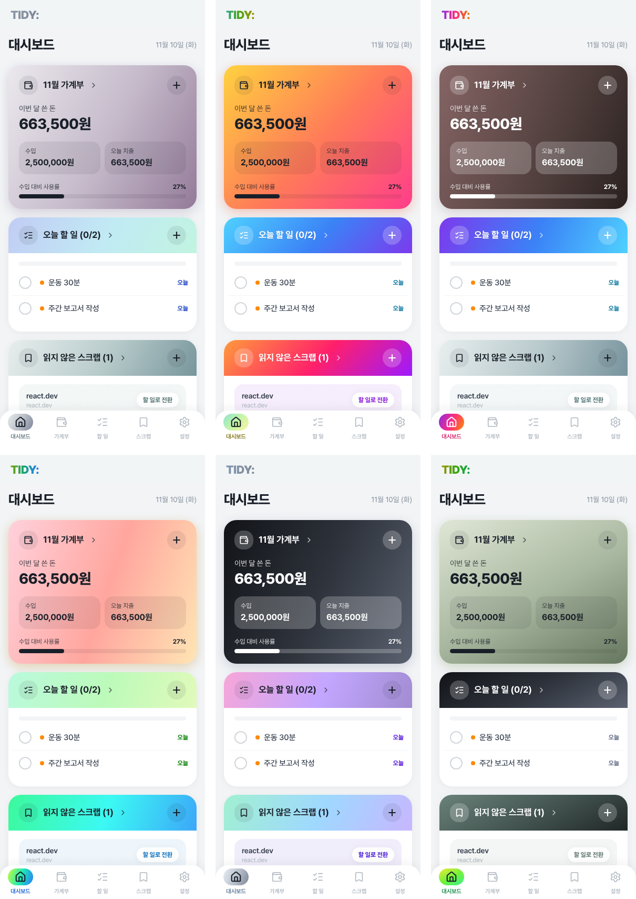
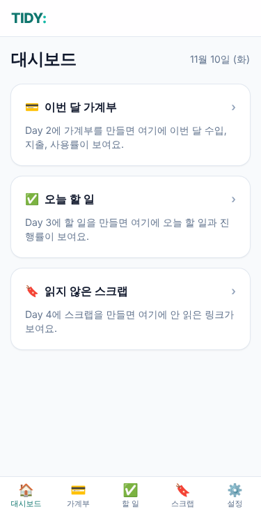
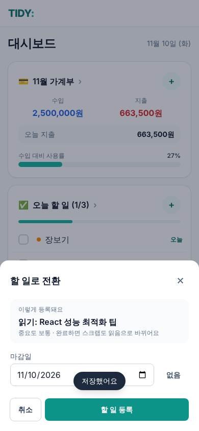
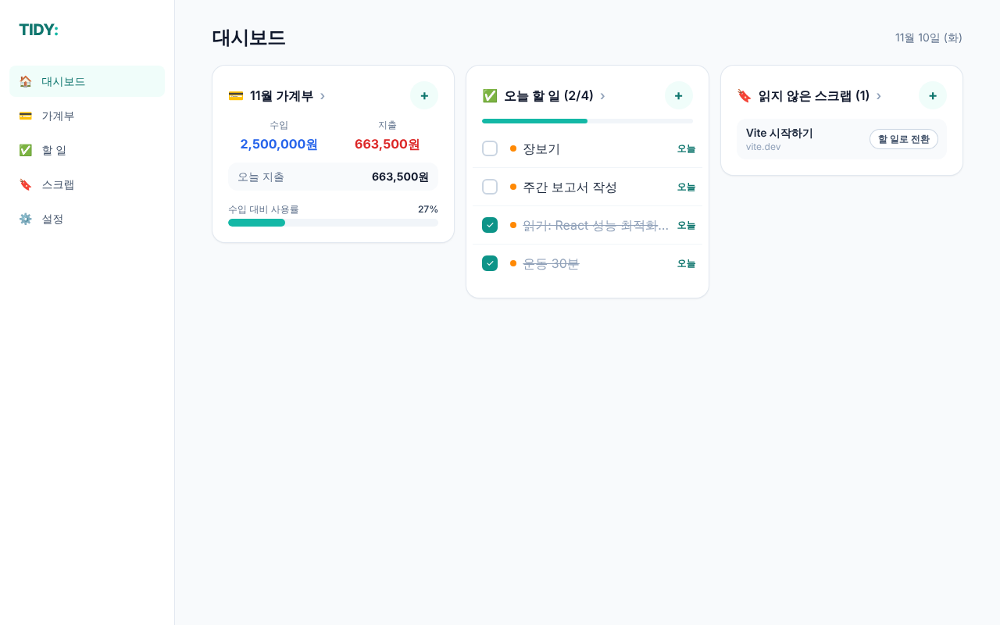
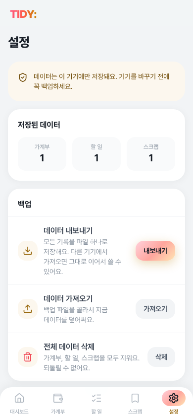
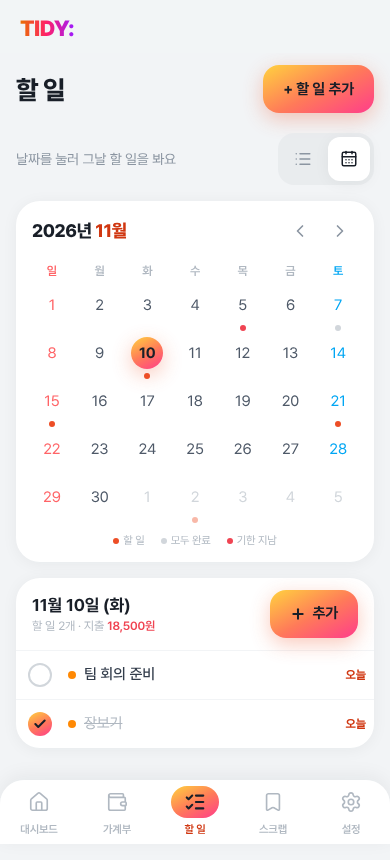
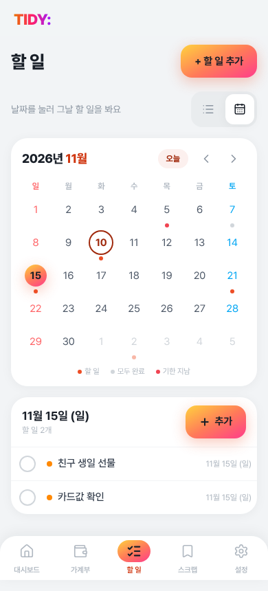

<div align="center">

# TIDY:

**돈, 할 일, 읽을거리를 한곳에서 깔끔하게.**

가계부 · 할 일 · 스크랩을 하나로 묶은 개인용 생활 정리 앱

폰 앱 · 컴퓨터 앱 · 폰 웹 · 컴퓨터 웹 &nbsp;|&nbsp; 서버 없이 내 기기에만 저장 &nbsp;|&nbsp; 로그인 없음

`v0.1.0 (1차 MVP 개발 중)`

</div>

---

## Tidy는 어떤 앱인가요?

> **TIDY** (타이디 / TidyUp): '정돈된, 깔끔한'이라는 뜻으로, 일상 관리를 깔끔하게 해준다는 메시지를 담았습니다.

가계부 앱, 할 일 앱, 북마크 앱을 따로 쓰다 보면 앱을 계속 옮겨 다니게 됩니다. **Tidy**는 매일 쓰는 세 가지를 앱 하나에 모았습니다. 앱을 열면 첫 화면에서 **이번 달 돈 흐름, 오늘 할 일, 아직 안 읽은 스크랩**을 한눈에 봅니다.

```text
┌──────────────────────────────────────────────────────────────────────────────┐
│  TIDY:                                                              ⚙️ 설정   │
├────────────────────────┬────────────────────────┬────────────────────────────┤
│ 💳 이번 달 가계부         │ ✅ 오늘 할 일 (3/5)       │ 🔖 읽지 않은 스크랩 (2)       │
│                        │                        │                            │
│ 수입  3,500,000원       │ ☑ 주간 업무 보고서 작성    │ • React 성능 최적화 팁        │
│ 지출  1,240,000원       │ ☐ 마트 장보기            │   └ [할 일로 전환]           │
│ 오늘     32,000원       │ ☐ 스크랩한 아티클 읽기     │ • 주말 추천 맛집 리스트        │
│ ███████░░░░░░  35% 사용 │                        │                            │
└────────────────────────┴────────────────────────┴────────────────────────────┘
```

## 주요 기능

### 💳 가계부
- 수입/지출을 금액, 날짜, 카테고리, 메모와 함께 기록
- 월별 내역을 날짜별로 묶어서 보기, 이전/다음 달 이동
- 이번 달 총 수입, 총 지출, 잔액 자동 계산
- 기본 카테고리: 식비, 교통, 쇼핑, 문화/여가, 주거/통신, 의료/건강, 교육 / 월급, 용돈, 부수입

### ✅ 할 일
- 할 일 등록, 수정, 삭제, 완료 체크
- 마감일과 중요도(높음/보통/낮음)
- **오늘** 탭(오늘 마감 + 기한 지난 일)과 **전체** 탭

### 🔖 스크랩
- 나중에 볼 링크를 제목, 메모와 함께 카드로 저장
- 누르면 브라우저에서 바로 열리고 자동으로 "읽음" 처리
- 읽음/안 읽음 토글과 필터

### 🔗 기능 연동
- **스크랩 → 할 일**: 스크랩 카드에서 버튼 한 번으로 "읽기: ○○○" 할 일 등록
- 그 할 일을 완료하면 스크랩도 자동으로 읽음 처리

### 🔒 내 데이터는 내 기기에
- 서버 없이 기기 안에 저장해서 인터넷이 없어도 동작
- 설정에서 **JSON 백업 내보내기/가져오기**로 기기를 옮겨도 그대로

## 화면 미리보기

> 만들면서 찍은 화면이에요. 날마다 새 화면이 생기면 [docs/screenshots](docs/screenshots)에 추가해요.

| 폰 (대시보드) | 폰 (가계부) | 폰 (할 일) | 폰 (스크랩) |
|:---:|:---:|:---:|:---:|
|  |  |  |  |


**디자인**: 토스처럼 둥글고 깔끔한 카드, 글씨체는 Pretendard. 색은 **앱을 켤 때마다 랜덤**이에요. 대시보드, 가계부, 할 일, 스크랩이 각자 세 가지 색 그라데이션을 하나씩 받아요. 견본 18개(파스텔, 쨍한 색, 무채색) 중에서 고르거나 어울리는 세 색을 새로 만들고, 밝은 색이면 글자를 검정으로 바꿔요.

**켤 때마다 바뀌는 색** (같은 데이터로 새로고침 여섯 번)



<details>
<summary>날짜별 화면 전체 보기</summary>

**Day 1 · 기본 화면과 메뉴**

 

**Day 2 · 가계부**

  

**Day 3 · 할 일**

 

**Day 4 · 스크랩**

 

**Day 5 · 대시보드와 스크랩 → 할 일**

     

**Day 6 · 카테고리 필터와 예외 처리**

   

**디자인 새로 입히기 (Day 6 뒤)**

   


**Day 7 · 백업과 앱 준비**

   

**2차 · 캘린더**

   

<details><summary>예전 디자인 (Day 5까지)</summary>

 

</details>

</details>

## 어디서 쓸 수 있나요?

| 환경 | 방법 | 상태 |
|---|---|---|
| 📱 폰 웹 | 브라우저로 접속, 홈 화면에 추가 | 🛠 개발 중 |
| 💻 컴퓨터 웹 | 브라우저로 접속, "앱 설치" 가능 | 🛠 개발 중 |
| 📱 폰 앱 | Android (iOS는 선택) | 🛠 개발 중 |
| 💻 컴퓨터 앱 | Chrome/Edge "앱 설치"로 별도 창 앱 (Windows · macOS) | 🛠 개발 중 |

## 기술 스택

| 구분 | 사용 기술 |
|---|---|
| 화면 | React 19 · TypeScript · Vite 8 · Tailwind CSS 4 |
| 디자인 | Pretendard 글씨체 · Lucide 아이콘 · 켤 때마다 바뀌는 세 가지 색 그라데이션 |
| 저장 | IndexedDB (Dexie.js) — 서버 없음 |
| 웹 | PWA (오프라인, 홈 화면 설치) |
| 폰 앱 | Capacitor |
| 컴퓨터 앱 | PWA 설치 (별도 패키징 없음, 용량 거의 0) |
| 기획 | [GitHub Spec Kit](https://github.com/github/spec-kit) (스펙 주도 개발) |

**하나의 코드**로 웹을 만들고, 같은 결과물을 폰에서는 Capacitor로 감싸 앱으로, 컴퓨터에서는 PWA로 설치해서 네 가지 환경에서 씁니다.

## 기획 문서

Spec Kit 방식으로 "무엇을 → 어떻게 → 할 일" 순서로 정리했습니다.

| 문서 | 내용 |
|---|---|
| [헌법 (constitution)](.specify/memory/constitution.md) | 프로젝트가 지키는 5가지 원칙 |
| [상세 요구사항 (spec)](specs/001-tidy-mvp/spec.md) | 사용자 시나리오 7개, 기능 요구사항, 예외 상황, 성공 기준 |
| [구현 계획 (plan)](specs/001-tidy-mvp/plan.md) | 구조, 화면 구성, 핵심 로직 |
| [기술 선택 이유 (research)](specs/001-tidy-mvp/research.md) | 왜 React, Dexie, Capacitor, PWA인지 |
| [데이터 모델](specs/001-tidy-mvp/data-model.md) | 테이블 3개, 필드 규칙, 백업 형식 |
| [작업 목록 (tasks)](specs/001-tidy-mvp/tasks.md) | 7일 일정, 74개 작업 |
| [개발 환경 세팅 (quickstart)](specs/001-tidy-mvp/quickstart.md) | 설치와 실행 명령어 |
| [2차 추가 요구사항](specs/002-tidy-phase2/spec.md) | 캘린더, 구글 로그인 + 동기화, AI 캡처 자동 입력 |
| [원본 요구사항 PDF](docs/MVP-요구사항-분석서.pdf) | 처음 작성한 MVP 요구사항 분석서 |

## 진행 상황 (7일 스프린트)

- [x] 기획: 상세 요구사항, 구현 계획, 작업 목록
- [x] Day 1 — 프로젝트 세팅, 레이아웃, DB
- [x] Day 2 — 가계부
- [x] Day 3 — 할 일
- [x] Day 4 — 스크랩
- [x] Day 5 — 대시보드, 스크랩 → 할 일 연동
- [x] Day 6 — 필터, 예외 처리, 디자인 정돈
- [x] Day 7 — 백업, PWA, 폰 앱 준비 (배포와 폰 설치는 [quickstart.md](specs/001-tidy-mvp/quickstart.md) 4~6번)

## 시작하기

```bash
git clone https://github.com/kcr522/tidy.git
cd tidy
npm install
npm run dev      # http://localhost:5173 에서 열기
npm test         # 단위 테스트
npm run app:ios      # 아이폰 앱 (Mac + Xcode)
npm run app:android  # 안드로이드 앱 (Android Studio)
```

자세한 내용은 [quickstart.md](specs/001-tidy-mvp/quickstart.md)를 보세요.

## 로드맵

### 2차 (1차 MVP 완성 후) — [상세 요구사항](specs/002-tidy-phase2/spec.md)

| 순서 | 기능 | 내용 |
|---|---|---|
| 1 | 📅 캘린더 ✅ | 날짜별 할 일 보기, 날짜를 눌러 바로 할 일 추가 |
| 2 | 🔐 구글 로그인 | 회원가입 없이 구글 계정으로 로그인, 폰·컴퓨터·웹 데이터 자동 동기화 (로그인 없이도 사용 가능) |
| 3 | 🤖 AI 캡처 입력 | 은행/카드 앱 캡처를 올리면 AI가 날짜·금액·가게를 읽어 가계부에 입력, 잔액 캡처로 실제 잔액 확인 |
| + | 🏷️ 가게 로고 | 다이소, 올리브영 같은 브랜드는 로고와 "지점 + 가게 이름"으로 표시, 모르는 결제처는 물어보고 기억 |

### 그 이후

가계부 ↔ 할 일 연동, 지출 그래프, 예산 설정, 반복 할 일과 알림, 스크랩 태그/검색, 구글 캘린더 연동, 다크 모드

---

<div align="center">
Made for my everyday life · 2026
</div>
