<div align="center">

# TIDY:

**돈, 할 일, 읽을거리를 한곳에서 깔끔하게.**

가계부 · 할 일 · 스크랩을 하나로 묶은 개인용 생활 정리 앱

폰 앱 · 컴퓨터 앱 · 폰 웹 · 컴퓨터 웹 &nbsp;|&nbsp; 서버 없이 내 기기에만 저장 &nbsp;|&nbsp; 로그인 없음 &nbsp;|&nbsp; AI는 무료만

`1차 MVP 완성` · `2차 (캘린더 · 일기 · 습관 · 적금 · AI 비서) 완성` · [안드로이드 앱 받기](https://github.com/kcr522/tidy/releases/latest)

</div>

---

## Tidy는 어떤 앱인가요?

> **TIDY** (타이디 / TidyUp): '정돈된, 깔끔한'이라는 뜻으로, 일상 관리를 깔끔하게 해준다는 메시지를 담았습니다.

가계부 앱, 할 일 앱, 북마크 앱을 따로 쓰다 보면 앱을 계속 옮겨 다니게 됩니다. **Tidy**는 매일 쓰는 세 가지를 앱 하나에 모았습니다. 앱을 열면 첫 화면에서 **이번 달 돈 흐름, 오늘 할 일, 아직 안 읽은 스크랩**을 한눈에 봅니다.

```text
┌──────────────────────────────────────────────────────────────────────────────┐
│  TIDY:                                                              ⚙️ 설정   │
├────────────────────────┬────────────────────────┬────────────────────────────┤
│ 💳 이번 달 가계부         │ ✅ 오늘 할 일 (3/5)       │ 🔖 읽지 않은 스크랩 (2)       │
│                        │                        │                            │
│ 수입  3,500,000원       │ ☑ 주간 업무 보고서 작성    │ • React 성능 최적화 팁        │
│ 지출  1,240,000원       │ ☐ 마트 장보기            │   └ [할 일로 전환]           │
│ 오늘     32,000원       │ ☐ 스크랩한 아티클 읽기     │ • 주말 추천 맛집 리스트        │
│ ███████░░░░░░  35% 사용 │                        │                            │
└────────────────────────┴────────────────────────┴────────────────────────────┘
```

## 주요 기능

### 💳 가계부
- 수입/지출을 금액, 날짜, 카테고리, 메모와 함께 기록
- 월별 내역을 날짜별로 묶어서 보기, 이전/다음 달 이동
- 이번 달 총 수입, 총 지출, 잔액 자동 계산
- 기본 카테고리: 식비, 교통, 쇼핑, 문화/여가, 주거/통신, 의료/건강, 교육 / 월급, 용돈, 부수입

### ✅ 할 일
- 할 일 등록, 수정, 삭제, 완료 체크
- 마감일과 중요도(높음/보통/낮음)
- **오늘** 탭(오늘 마감 + 기한 지난 일)과 **전체** 탭

### 🔖 스크랩
- 나중에 볼 링크를 제목, 메모와 함께 카드로 저장
- 누르면 브라우저에서 바로 열리고 자동으로 "읽음" 처리
- 읽음/안 읽음 토글과 필터

### 🔗 기능 연동
- **스크랩 → 할 일**: 스크랩 카드에서 버튼 한 번으로 "읽기: ○○○" 할 일 등록
- 그 할 일을 완료하면 스크랩도 자동으로 읽음 처리

### 🔒 내 데이터는 내 기기에
- 서버 없이 기기 안에 저장해서 인터넷이 없어도 동작
- 설정에서 **JSON 백업 내보내기/가져오기**로 기기를 옮겨도 그대로

## 2차에서 더한 기능

> 자세한 내용: [2차 요구사항 분석서](specs/002-tidy-phase2/requirements.md) · [PDF (화면 사진 포함)](docs/2차-요구사항-분석서.pdf)

| 구역 | 더한 기능 |
|---|---|
| 💳 가계부 | 시간 · 결제 수단, 가게 로고, 모르는 결제처 물어보고 기억, 정기 내역 + 월급 D-day, 차트 · 통계 · 고정 금액, 목록 / 달력, **캡처로 입력(기기 안 글자 인식, 무료)**, 음식 사진으로 식비, AI 소비 한마디, 적금 |
| ✅ 할 일 · 📅 캘린더 | 월 달력(여러 날 일정 막대), 날짜 눌러 추가, 금액 보기, 나중 할 일, **습관 트래커**(연속 일수 🔥) |
| 📔 일기 | 하루 글 + **사진 최대 10장 타임라인**(찍은 시간 · 한 줄 메모), 아이폰 사진(HEIC) |
| 🔖 스크랩 | 카테고리, 링크 미리보기, 공유로 저장, 캡처 같이 저장 + 사진 편집, 인스타 영상 앱 안에서 보기, AI 요약 |
| ✨ AI 비서 | 사진 · 글로 일정 / 가계부 / 일기 등록, **물어보기**(예금 · 적금 · 청년 상품 · 돈 관리, 구글 검색 출처), Gemini 무료 → Groq 무료 → 기본 모드 |
| 🎨 꾸미기 | 켤 때마다 바뀌는 색, 다크 / 라이트 / 자동, 구역마다 사진 10장 + 전체 보이기 / 꽉 채우기, 체크 색 |
| 📱 앱 · 🔒 보안 | 안드로이드 APK 자동 빌드, 지우지 않고 업데이트, 위험한 링크 막기, 보안 헤더, 키는 기기 안에만 |

## 화면 미리보기

> 만들면서 찍은 화면이에요. 날마다 새 화면이 생기면 [docs/screenshots](docs/screenshots)에 추가해요.

| 폰 (대시보드) | 폰 (가계부) | 폰 (할 일) | 폰 (스크랩) |
|:---:|:---:|:---:|:---:|
|  |  |  | 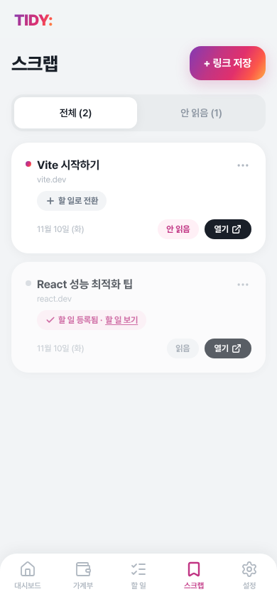 |

**AI 비서** (첫 화면 오른쪽 아래 동그라미): 포스터 → 캘린더, 결제 내역 캡처 → 가계부, 오늘 이야기 → 일기

| 포스터 사진 | 결제 내역 캡처 | 오늘 있었던 일 | 내가 등록할게 |
|:---:|:---:|:---:|:---:|
| 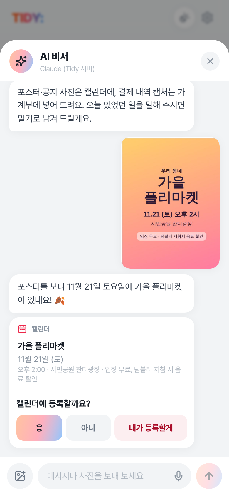 | 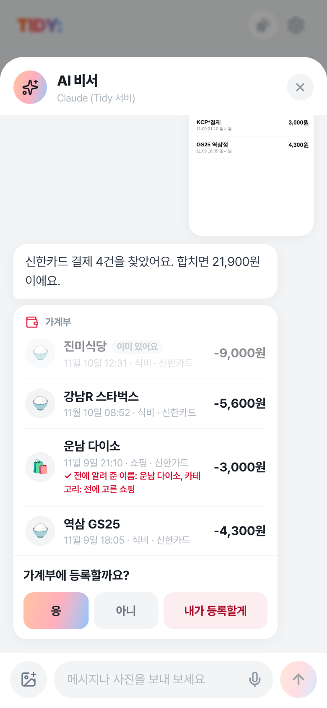 |  |  |

**스크랩 바로 캡처** (안드로이드 앱): 저장 → "캡처할래요?" → 앱 안에서 사이트 열기 → 캡처 → 자르기

| 캡처할래요? | 앱 안 사이트 (모형) | 자르기 | 저장된 캡처 |
|:---:|:---:|:---:|:---:|
|  |  |  |  |

**2차 새 화면**

| 일기 타임라인 | 습관 | 적금 | 꾸미기 사진 |
|:---:|:---:|:---:|:---:|
| 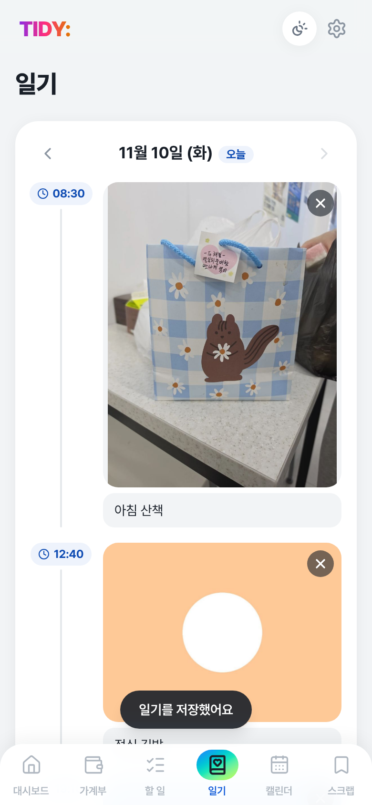 |  |  |  |

| 캘린더 | 가계부 달력 | 캡처로 입력 | AI 연결 (Groq 예비) |
|:---:|:---:|:---:|:---:|
| 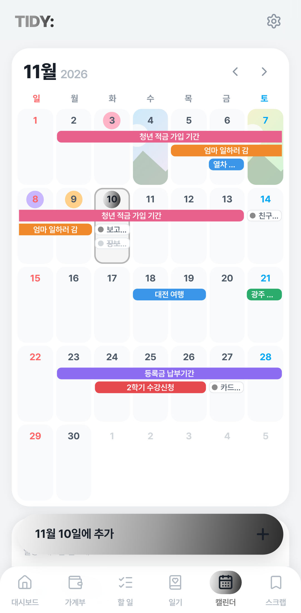 |  | 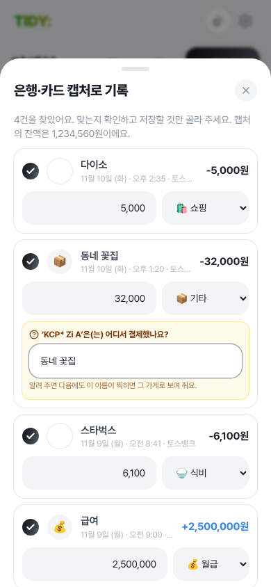 | 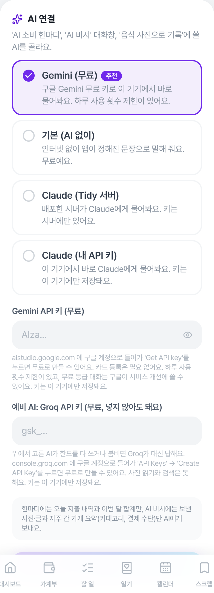 |

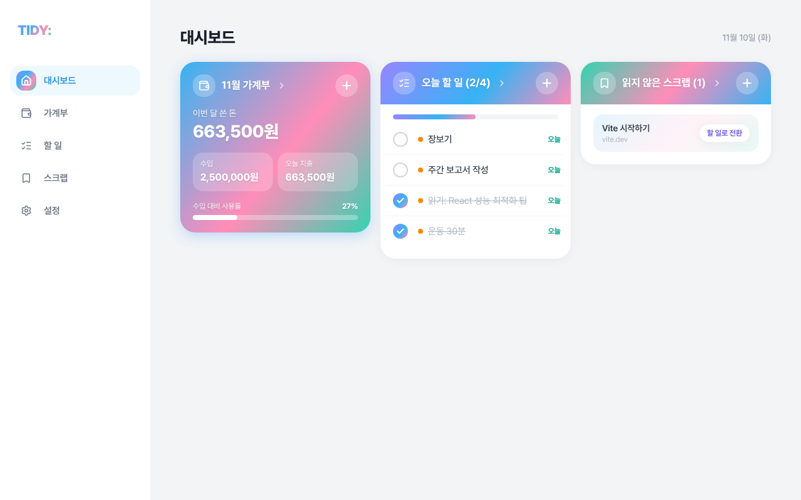

**디자인**: 토스처럼 둥글고 깔끔한 카드, 글씨체는 Pretendard. 색은 **앱을 켤 때마다 랜덤**이에요. 대시보드, 가계부, 할 일, 스크랩이 각자 세 가지 색 그라데이션을 하나씩 받아요. 견본 18개(파스텔, 쨍한 색, 무채색) 중에서 고르거나 어울리는 세 색을 새로 만들고, 밝은 색이면 글자를 검정으로 바꿔요.

**켤 때마다 바뀌는 색** (같은 데이터로 새로고침 여섯 번)


<details>
<summary>날짜별 화면 전체 보기</summary>

**Day 1 · 기본 화면과 메뉴**

 

**Day 2 · 가계부**

  

**Day 3 · 할 일**

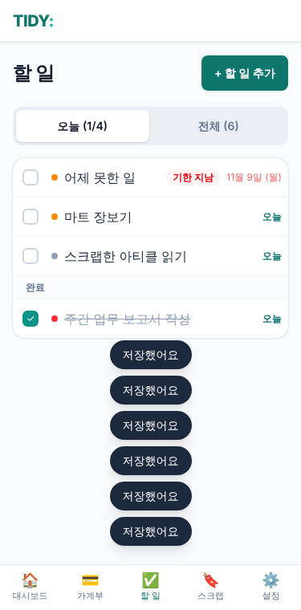 

**Day 4 · 스크랩**

 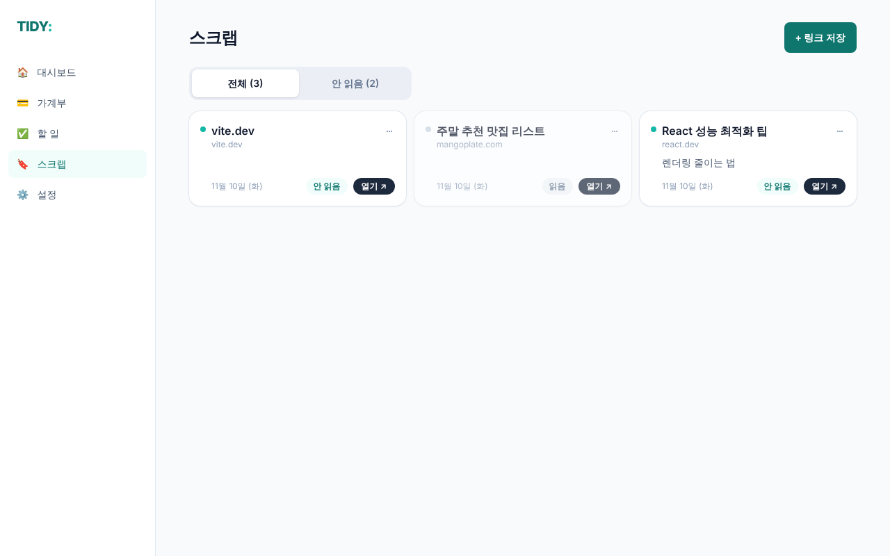

**Day 5 · 대시보드와 스크랩 → 할 일**

     

**Day 6 · 카테고리 필터와 예외 처리**

   

**디자인 새로 입히기 (Day 6 뒤)**

 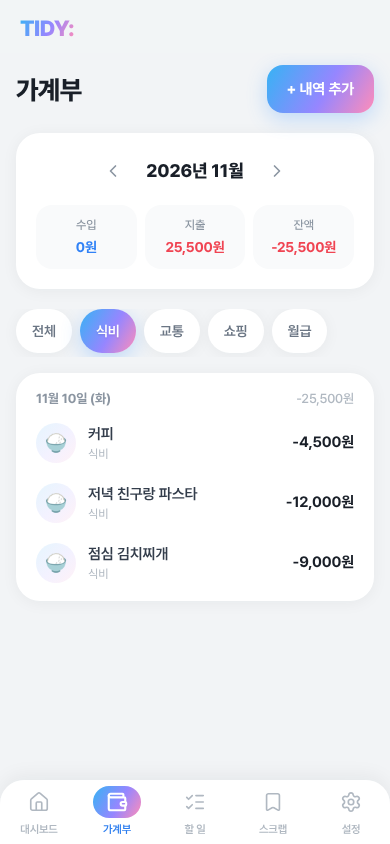  


**Day 7 · 백업과 앱 준비**

 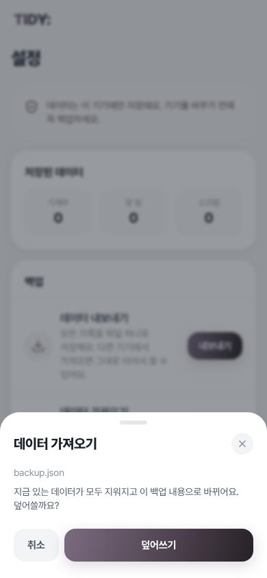  

**2차 · 캘린더**

   

**2차 · 가게 로고**

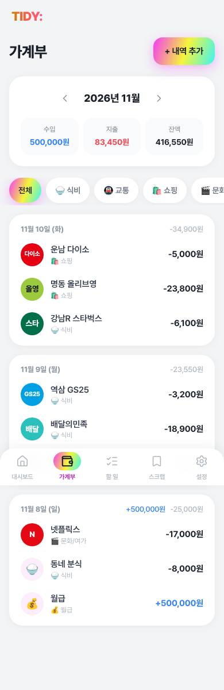 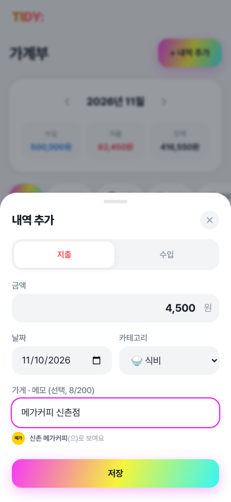

**2차 · 시간, 결제 수단, 자세히 보기**

   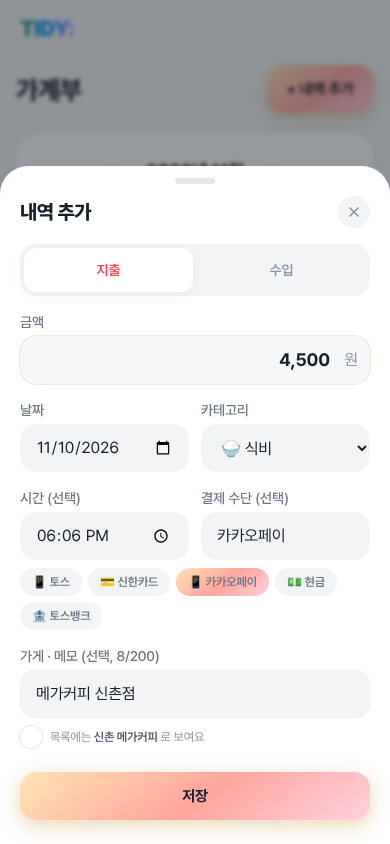

**2차 · 정기 내역, 월급 D-day**

 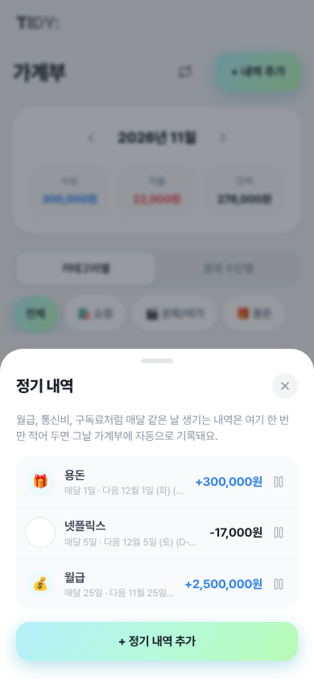 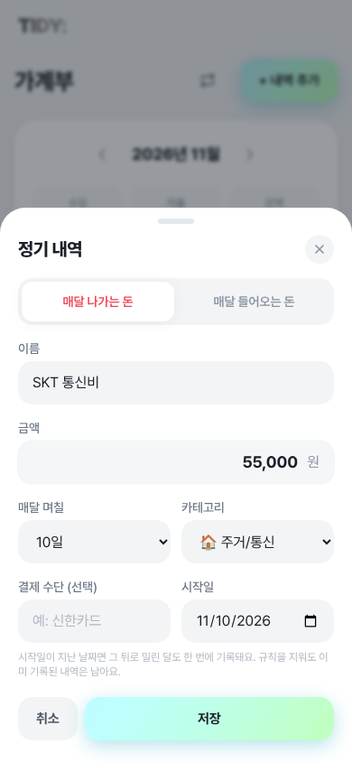

**2차 · 모르는 결제처 물어보기**

  

**2차 · 가계부 메뉴 (≡): 차트, 통계, 고정 금액**

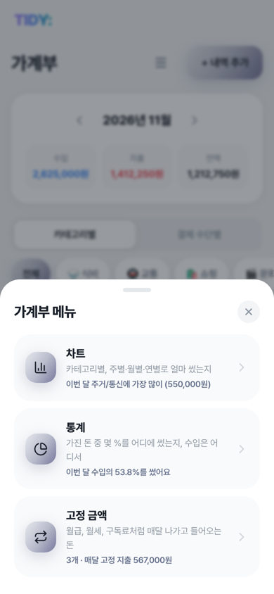   

**2차 · 음식 사진으로 기록 (📷): 사진 위치·시간 → 가게·메뉴 → "이 가격 맞아요?"**

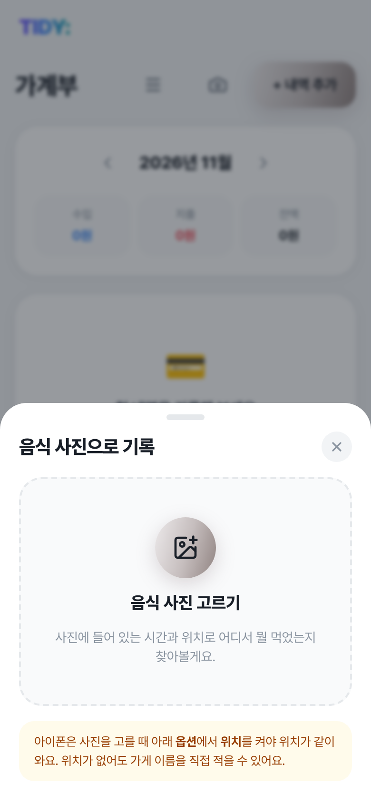    

**2차 · 다크 / 라이트 / 자동 화면 밝기**

  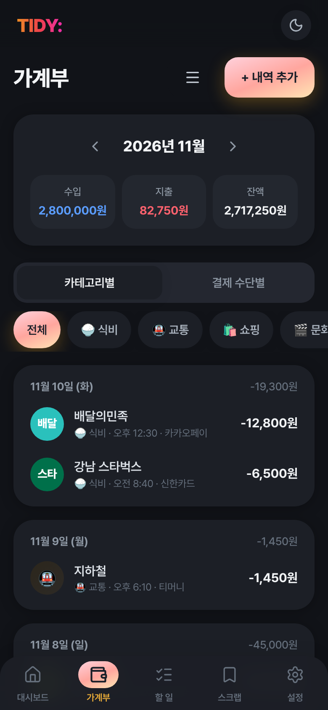 

**2차 · 꾸미기 (설정): 배경·구역마다 사진, 투명도, 랜덤 색 / 고정 색**

   

 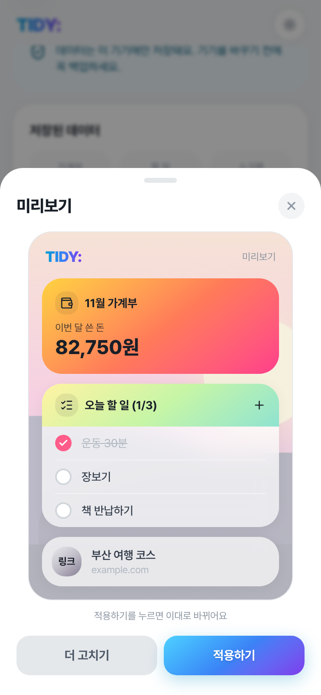 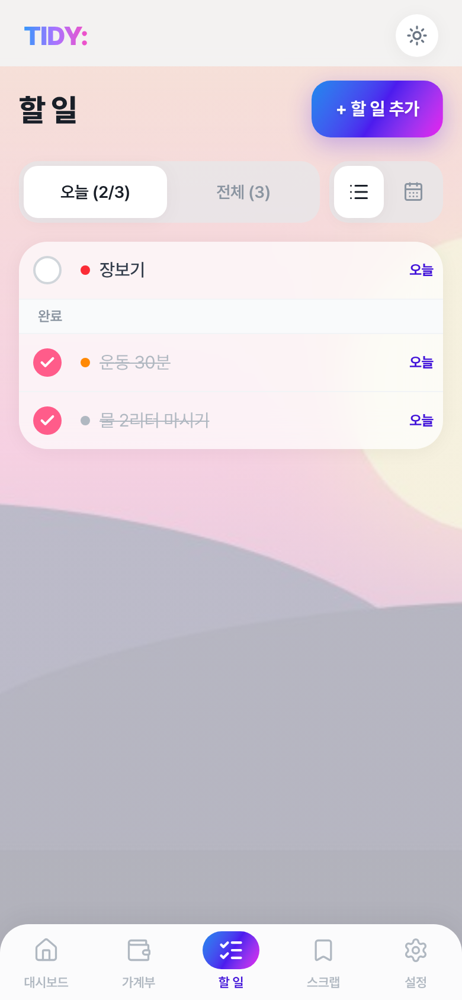

**캡처로 가계부 입력 (AI 없이, 기기 안 글자 인식)**

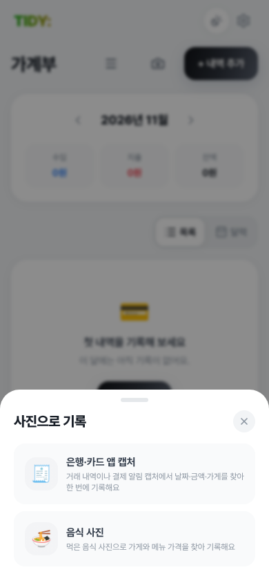   

**2차 · 적금 (만기 금액 세전/세후, 습관, 알림)**

    

**2차 · 습관 트래커**

   

**2차 · 스크랩 (카테고리, 공유, 캡처, 편집)**

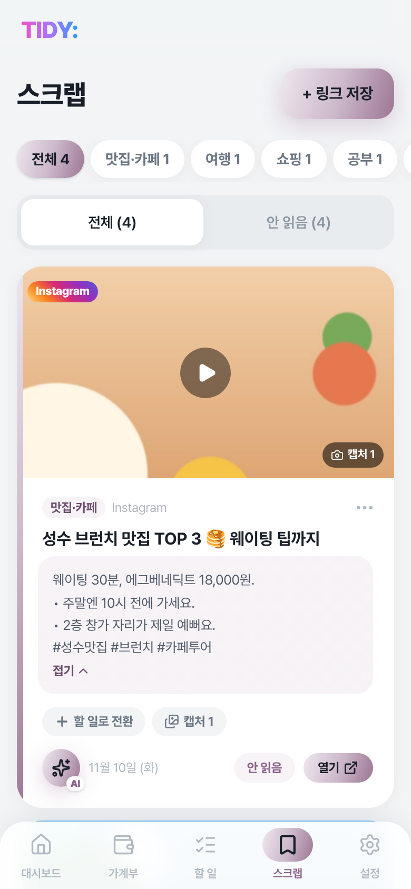   

**2차 · AI 비서 (무료 Gemini, 예비 Groq)**

   

**2차 · 꾸미기 사진 여러 장, 사진 맞춤**

  

**2차 · 일기 (아이폰 사진, 사진 타임라인)**

 

**2차 · 화면 정돈 (컴퓨터 대시보드 칸 크기, 작은 폰 가계부 머리)**

 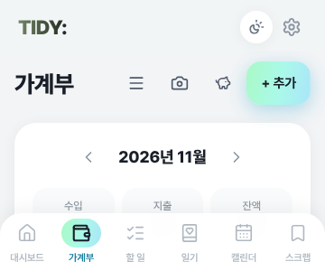

<details><summary>예전 디자인 (Day 5까지)</summary>

 

</details>

</details>

## 어디서 쓸 수 있나요?

| 환경 | 방법 | 상태 |
|---|---|---|
| 📱 폰 앱 | Android: [Releases](https://github.com/kcr522/tidy/releases/latest)에서 `tidy.apk` 받아 설치, 새 APK를 덮어 깔면 기록 그대로 업데이트 | ✅ 사용 중 |
| 📱 폰 웹 | 브라우저로 접속, 홈 화면에 추가 | ⏳ 인터넷 주소(Vercel) 배포 전 |
| 💻 컴퓨터 웹 | 브라우저로 접속, "앱 설치" 가능 | ⏳ 배포 전 (`npm run dev`로는 사용 가능) |
| 💻 컴퓨터 앱 | Chrome/Edge "앱 설치"로 별도 창 앱 (Windows · macOS) | ⏳ 배포 전 |
| 🍎 아이폰 앱 | Mac + Xcode로 빌드 (`npm run app:ios`) | 선택 |

## 기술 스택

| 구분 | 사용 기술 |
|---|---|
| 화면 | React 19 · TypeScript · Vite 8 · Tailwind CSS 4 |
| 디자인 | Pretendard 글씨체 · Lucide 아이콘 · 켤 때마다 바뀌는 세 가지 색 그라데이션 |
| 저장 | IndexedDB (Dexie.js) — 서버 없음 |
| 웹 | PWA (오프라인, 홈 화면 설치) |
| 폰 앱 | Capacitor (안드로이드 APK는 GitHub Actions가 자동으로 만들어 Releases에 올림) |
| AI (무료) | Gemini 무료 키 → Groq 무료 키(예비) → 기본 모드(규칙). 글자 인식은 기기 안 Tesseract.js, 아이폰 사진은 heic-to (쓸 때만 불러옴) |
| 컴퓨터 앱 | PWA 설치 (별도 패키징 없음, 용량 거의 0) |
| 기획 | [GitHub Spec Kit](https://github.com/github/spec-kit) (스펙 주도 개발) |

**하나의 코드**로 웹을 만들고, 같은 결과물을 폰에서는 Capacitor로 감싸 앱으로, 컴퓨터에서는 PWA로 설치해서 네 가지 환경에서 씁니다.

## 기획 문서

Spec Kit 방식으로 "무엇을 → 어떻게 → 할 일" 순서로 정리했습니다.

| 문서 | 내용 |
|---|---|
| [헌법 (constitution)](.specify/memory/constitution.md) | 프로젝트가 지키는 5가지 원칙 |
| [상세 요구사항 (spec)](specs/001-tidy-mvp/spec.md) | 사용자 시나리오 7개, 기능 요구사항, 예외 상황, 성공 기준 |
| [구현 계획 (plan)](specs/001-tidy-mvp/plan.md) | 구조, 화면 구성, 핵심 로직 |
| [기술 선택 이유 (research)](specs/001-tidy-mvp/research.md) | 왜 React, Dexie, Capacitor, PWA인지 |
| [데이터 모델](specs/001-tidy-mvp/data-model.md) | 테이블 3개, 필드 규칙, 백업 형식 |
| [작업 목록 (tasks)](specs/001-tidy-mvp/tasks.md) | 7일 일정, 74개 작업 |
| [개발 환경 세팅 (quickstart)](specs/001-tidy-mvp/quickstart.md) | 설치와 실행 명령어 |
| [2차 처음 기획](specs/002-tidy-phase2/spec.md) | 캘린더, 구글 로그인 + 동기화, AI 캡처 자동 입력 |
| [**2차 요구사항 분석서**](specs/002-tidy-phase2/requirements.md) · [PDF](docs/2차-요구사항-분석서.pdf) | 실제로 만든 2차 기능 명세표, DB 설계(v1~v7), 무료 AI 구조, 아직 안 만든 것 |
| [원본 요구사항 PDF](docs/MVP-요구사항-분석서.pdf) | 처음 작성한 MVP 요구사항 분석서 |

## 진행 상황 (7일 스프린트)

- [x] 기획: 상세 요구사항, 구현 계획, 작업 목록
- [x] Day 1 — 프로젝트 세팅, 레이아웃, DB
- [x] Day 2 — 가계부
- [x] Day 3 — 할 일
- [x] Day 4 — 스크랩
- [x] Day 5 — 대시보드, 스크랩 → 할 일 연동
- [x] Day 6 — 필터, 예외 처리, 디자인 정돈
- [x] Day 7 — 백업, PWA, 폰 앱 준비 (배포와 폰 설치는 [quickstart.md](specs/001-tidy-mvp/quickstart.md) 4~6번)

**2차**

- [x] 캘린더, 일기, 가계부 달력 (#12, #18)
- [x] 가게 로고, 시간 · 결제 수단, 정기 내역, 모르는 결제처 물어보기 (#13 ~ #16)
- [x] 차트 · 통계 · 고정 금액 (#17)
- [x] 다크 모드, 꾸미기 (#19, #33)
- [x] AI 소비 한마디, AI 비서, 물어보기 (#20, #25, #33)
- [x] 음식 사진 기록, 캡처로 입력 (#21, #26, #27)
- [x] 스크랩 카테고리 · 공유 · 캡처 (#23), 습관 (#22), 적금 (#24)
- [x] 무료 AI: Gemini → Groq → 기본 모드 (#28 ~ #30, #34, #35)
- [x] 안드로이드 앱 자동 빌드 + 지우지 않고 업데이트 (#26, #32), 보안 점검 (#33)
- [ ] 일기 사진 10장 타임라인 (#36 검토 중)
- [ ] 웹 배포 (Vercel), 구글 로그인 + 동기화

## 시작하기

```bash
git clone https://github.com/kcr522/tidy.git
cd tidy
npm install
npm run dev      # http://localhost:5173 에서 열기
npm test         # 단위 테스트
npm run app:ios      # 아이폰 앱 (Mac + Xcode)
npm run app:android  # 안드로이드 앱 (Android Studio)
```

자세한 내용은 [quickstart.md](specs/001-tidy-mvp/quickstart.md)를 보세요.

## 로드맵

### 2차 — [요구사항 분석서](specs/002-tidy-phase2/requirements.md)

| 순서 | 기능 | 상태 |
|---|---|---|
| 1 | 📅 캘린더 · 일기 · 습관 · 적금 | ✅ 완성 |
| 2 | 🤖 캡처 · 사진으로 입력, AI 비서 (무료) | ✅ 완성 (Groq는 실제 키로 확인 중) |
| 3 | 🌐 웹 배포 (Vercel) | ⏳ 다음 |
| 4 | 🔐 구글 로그인 + 동기화 (10명 정도, Firebase) | ⏳ 정해만 둠 |

### 3차 후보

🔒 앱 잠금(지문 · 비밀번호) · 💰 월 예산 + 알림 · 🔁 반복 할 일 + 알림 · 🔎 전체 검색 · 📊 월말 리포트 · 📱 홈 화면 위젯 · ☁️ 자동 백업 · 🗓 구글 캘린더 연동 · 💳 잔액 캡처 확인 · 🍎 아이폰 공유로 스크랩

---

<div align="center">
Made for my everyday life · 2026
</div>
