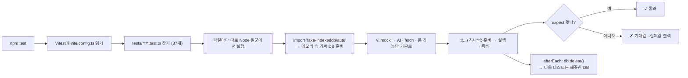

# Tidy 테스트 코드 정리

Tidy에 어떤 테스트가 있고, 어디에 있고, 어떻게 돌아가는지 한 번에 볼 수 있게 정리한 문서예요.
테스트를 **어떻게 써야 하는지**(이름 · 모양 규칙)는 [테스트 코드 작성 규칙](테스트-코드-규칙.md)에 따로 있어요.

> 기준: 2026-11-27, `preview/all-features` 브랜치. `npm test` 결과 **테스트 파일 87개 · 테스트 1,520개 모두 통과** (약 23초).
> 기능 · 테스트를 더할 때마다 쓰는 테스트 기록은 [테스트 문서 폴더](README.md)에 모아요.

---

## 1. 한눈에 보기

Tidy의 "확인 장치"는 네 겹이에요. 위로 갈수록 자주, 빠르게 돌고, 아래로 갈수록 실제 사용 환경에 가까워요.

| 층 | 무엇을 확인하나 | 도구 | 언제 도나 |
|---|---|---|---|
| ① 단위 테스트 | 계산 · 저장 · 글 읽기 같은 **앱 안 로직**이 맞게 동작하는지 | Vitest + fake-indexeddb | 개발할 때 `npm test` (PR 만들 때마다 손으로 돌림) |
| ② 정적 검사 | 타입이 맞는지, 실수하기 쉬운 코드 모양이 없는지 | TypeScript(`tsc`), oxlint | `npm run build` 안의 `tsc -b`는 **배포 · APK 빌드 때마다 자동**, oxlint는 `npm run lint`로 손으로 |
| ③ 평가 스크립트 | AI 비서가 문장을 얼마나 정확히 알아듣는지 (점수) | `scripts/ai-eval.ts` | 필요할 때 손으로 |
| ④ 빌드 · 배포 확인 (CI) | APK에 플러그인이 빠지지 않았는지, 웹 사이트가 새 버전으로 바뀌었는지, 폰에서 패키지 이름이 맞는지 | GitHub Actions, Android 기기 테스트 | 브랜치에 올리거나 합칠 때 자동 |

---

## 2. 폴더 구조

```
tidy/
├─ vite.config.ts            ← 맨 아래 test: { environment: 'node', include: ['tests/**/*.test.ts'] }
├─ package.json              ← "test": "vitest run", "test:watch": "vitest", "lint": "oxlint"
├─ tests/
│  ├─ unit/      (85개)      ← 기능별 단위 테스트. 파일 이름 = 시험하는 src 파일 이름
│  │   ├─ transactionRepo.test.ts   → src/repositories/transactionRepo.ts
│  │   ├─ validate.test.ts          → src/lib/validate.ts
│  │   └─ …
│  ├─ lib/       (2개)       ← route.test.ts, mapTile.test.ts (이동 기록 지도)
│  └─ fixtures/              ← 테스트에 쓰는 진짜 파일
│      └─ meal-gps.jpg       ← GPS · 찍은 시각이 들어 있는 음식 사진 (meal.test.ts)
├─ scripts/
│  └─ ai-eval.ts             ← AI 비서 정확도 평가 (21개 문장)
├─ android/app/src/androidTest/java/com/kcr522/tidy/
│  └─ AppPackageTest.java    ← 실제 폰 · 에뮬레이터에서 도는 기기 테스트
└─ .github/workflows/
   ├─ android.yml            ← APK 빌드 + 플러그인 빠짐 확인
   ├─ web-deploy.yml         ← 사이트가 새 버전으로 바뀌었는지 확인
   ├─ desktop-widget.yml     ← 맥 · 윈도우 위젯 앱 빌드
   ├─ dev-record.yml         ← 개발 기록 자동 정리 (테스트는 아님)
   └─ brand-logos.yml        ← 가게 로고 받기 (테스트는 아님)
```

규칙은 간단해요. **`src/어딘가/이름.ts`를 시험하는 파일은 `tests/unit/이름.test.ts`** 예요. 그래서 어떤 기능의 테스트를 찾고 싶으면 파일 이름으로 바로 찾을 수 있어요.

### 기능별로 나누면

| 기능 | 파일 수 | 예시 파일 |
|---|---|---|
| 가계부 | 21 | transactionRepo, moneyExport(엑셀 내보내기), recurringAlarms(정기 지출 알림), budget, savings, payMethods, payNotify(결제 알림 읽기), bankText(은행 캡처 글), meal(음식 사진), moneyCategory, calc(계산기) |
| 달력 · 일기 | 14 | calendar, holidays(공휴일), ical(구글 캘린더 불러오기), gcalPush, deviceCal(삼성 캘린더), diaryHours, diaryDigest, diaryMood |
| 데이터 · 기기 · 이동 | 12 | database(DB 버전 올리기), sync(Firebase 동기화), backupRepo, autoBackup, jsonChunks, appLock, appUpdate, search, route |
| 스크랩 | 11 | scrap, bookmarkRepo, scrapClassify(분류), scrapSuggest, pageContent(사이트 글 읽기), instagramSaved |
| 꾸미기 · 화면 | 11 | customize, colorMode, palette, appFont, dashLayout(위젯 배치), dashExtras(타이머 · 기분 · 날씨 위젯), widgetSummary(홈 화면 위젯) |
| 할 일 · 습관 | 6 | todos, todoRepeat(반복), todoAlarms(알림), todoCalendar, recurring, habits |
| 메모 · 첨부 | 6 | memo, richText, handwritingPen(손글씨), attachments, heic(아이폰 사진) |
| AI · 서버 | 6 | assistant(48개로 가장 많음), quickAnswer, groq, serverAi, adminServer |

**무엇을 시험하지 않나:** 화면(React 컴포넌트 · 페이지)은 단위 테스트가 없어요. 화면은 PR마다 실제로 띄워서 찍은 **스크린샷**으로 확인해요. 그래서 로직은 되도록 `src/lib/`에 화면과 떼어서 두고, 그 부분을 테스트해요.

---

## 3. 쓰는 도구

| 도구 | 하는 일 | 왜 이걸 |
|---|---|---|
| **Vitest** | 테스트 실행기. `describe` · `it` · `expect` 를 제공 | Vite와 같은 설정(경로 · TypeScript)을 그대로 써서 따로 설정할 게 거의 없어요 |
| **fake-indexeddb** | 브라우저 DB(IndexedDB)를 Node 메모리 안에 흉내 냄 | 진짜 Dexie · TidyDB 코드를 그대로 돌려 볼 수 있어요. 34개 파일이 씀 |
| **vi.fn / vi.mock** | 함수 · 모듈을 가짜로 바꿈 | AI(Gemini · Groq), 인터넷(`fetch`), 폰 기능(Capacitor)처럼 느리거나 돈이 들거나 매번 결과가 다른 것만 |
| **vi.useFakeTimers** | 시계를 가짜로 | 기다리는 코드를 진짜로 기다리지 않게 |
| **oxlint** | 코드 검사 | ESLint보다 훨씬 빠름 |
| **JUnit + AndroidX Test** | 안드로이드 기기 테스트 | 안드로이드 기본 도구 |

환경은 `environment: 'node'` 예요. 브라우저를 띄우지 않고 Node에서 바로 돌아서 1,450개가 20초 남짓이면 끝나요.

---

## 4. 어떻게 돌리나

### 내 컴퓨터에서

```bash
npm test                                         # 전부 한 번 (vitest run)
npm run test:watch                               # 파일을 고칠 때마다 다시 돌림
npx vitest run tests/unit/budget.test.ts         # 파일 하나만
npx vitest run -t '예산'                          # 제목에 '예산'이 들어간 테스트만
npm run lint                                     # 코드 검사
npx vite-node scripts/ai-eval.ts                 # AI 비서 평가 (기본 모드, 키 없이)
GEMINI_KEY=… npx vite-node scripts/ai-eval.ts    # Gemini로 평가
```

> ⚠️ `ai-eval.ts` 맨 위 주석에는 `npx tsx scripts/ai-eval.ts`라고 적혀 있지만, 지금은 tsx로 돌리면 `import.meta.env`가 없어서 멈춰요 (AI 서버 기능이 생긴 뒤부터). `vite-node`로 돌리면 돼요. 2026-11-27 기본 모드 결과: **21개 중 17개 맞음** (틀린 4개는 일기 1개와 '금리 얼마야?' 같은 질문 3개).

### 결과 읽는 법

```
 ✓ tests/unit/validate.test.ts (32 tests) 29ms
 ✓ tests/unit/transactionRepo.test.ts (6 tests) 57ms
 …
 Test Files  87 passed (87)
      Tests  1520 passed (1520)
```

하나라도 틀리면 `✗`와 함께 **어떤 제목의 테스트가, 기대한 값과 실제 값이 어떻게 달랐는지** 보여 줘요. 제목이 "상황 → 기대 결과" 문장이라 실패 줄만 읽어도 무엇이 깨졌는지 알 수 있어요.

### GitHub Actions (자동)

| 작업 | 언제 | 확인하는 것 |
|---|---|---|
| **Android APK** (`android.yml`) | `claude/**` · `preview/**` · `main` 브랜치에 올릴 때 | ① `npm run build` 안의 `tsc -b`로 타입 검사 ② APK 빌드 ③ 용량 줄이기(R8)로 **플러그인 클래스(npm 플러그인 + 직접 만든 자바 클래스 13개)가 빠지지 않았는지** 하나씩 확인 → 하나라도 없으면 빨간 X. 합친 뒤엔 Releases에 올림 |
| **Web deploy** (`web-deploy.yml`) | `preview/all-features`에 합칠 때 | 사이트의 `/version.json` 커밋이 방금 합친 커밋과 같아질 때까지 20초마다 확인, 15분 넘으면 실패 |
| **Desktop widget** (`desktop-widget.yml`) | `desktop-widget/`가 바뀔 때 | 맥 · 윈도우에서 위젯 앱이 빌드되는지 |
| **Vercel 빌드** | 합칠 때 | `npm run build` (타입 검사 포함)가 성공해야 사이트가 바뀜 |

> 📌 **알아 둘 점:** 지금 GitHub Actions에는 **`npm test`(단위 테스트)와 `npm run lint`를 자동으로 돌리는 작업이 없어요.** PR을 만들 때 손으로 돌리고 PR 설명에 결과를 적어 왔어요. 자동으로 하려면 PR마다 `npm ci && npm test && npm run lint`를 도는 작은 작업 하나를 더하면 돼요 (1~2분, 무료 한도 안).

### 기기 테스트 (Android)

`AppPackageTest.java`는 실제 폰이나 에뮬레이터에 설치된 앱의 패키지 이름이 `com.kcr522.tidy`인지 확인해요. 이게 바뀌면 Google 로그인(OAuth)과 "예전 앱 위에 업데이트 설치"가 깨지기 때문이에요.
클라우드에는 에뮬레이터를 돌릴 환경이 없어서, 필요할 때만 GitHub Actions에 잠깐 에뮬레이터 작업(`android-emulator-runner`)을 만들어 돌렸어요 (예: X 공유 확인, PR #135). 평소 자동으로 돌지는 않아요.

---

## 5. 테스트 하나가 실제로 어떻게 작동하나

### 흐름



파일마다 따로 돌기 때문에 한 파일의 가짜 설정이 다른 파일에 새지 않고, 테스트마다 DB 이름을 다르게 주고 끝나면 지워서 **테스트끼리 서로 영향을 주지 않아요.**

### 예시 1 — DB에 저장하고 다시 읽기 (가짜로 바꾸는 것 없음)

`tests/unit/transactionRepo.test.ts` 에서 그대로 가져왔어요.

```ts
import 'fake-indexeddb/auto'                    // ① 브라우저 DB를 메모리에 흉내
import { afterEach, describe, expect, it } from 'vitest'
import { TidyDB } from '../../src/db/database'   // ② 앱이 쓰는 진짜 DB 코드
import { createTransactionRepo } from '../../src/repositories/transactionRepo'

let db: TidyDB
afterEach(async () => {
  await db?.delete()                             // ③ 테스트가 끝날 때마다 DB 지우기
})

/** 정상 점심 지출 15,000원 */
const okLunch = { type: 'EXPENSE' as const, amount: 15_000, category: '식비', memo: '점심', date: '2026-11-10' }

describe('transactionRepo', () => {
  it('금액을 고치면 바뀌고 만든 시각은 남는다 (US1 시나리오 4)', async () => {
    db = new TidyDB('repo-test-1')               // 준비: 이 테스트만의 DB
    const repo = createTransactionRepo(db)
    const id = await repo.add(okLunch)

    await repo.update(id, { ...okLunch, amount: 12_000 })   // 실행: 금액 고치기

    const updated = await repo.get(id)            // 확인: 바뀐 값 · 남은 값
    expect(updated?.amount).toBe(12_000)
    expect(updated?.createdAt).toBeDefined()
  })
})
```

읽는 법:
- **`describe`** = 묶음 이름, **`it`** = 테스트 하나. 제목은 "상황 → 기대 결과" 문장이고, 괄호 안 `US1 시나리오 4`는 요구사항 문서의 어느 항목을 확인하는지예요.
- `okLunch`처럼 **`ok`로 시작하는 값**은 "실제로 있을 법한 정상 값"이라는 표시예요. 필요한 칸만 `{ ...okLunch, amount: 12_000 }`처럼 바꿔요.
- 준비 / 실행 / 확인 사이에 빈 줄이 있어서 어디가 어디인지 바로 보여요.
- **`expect(실제).toBe(기대)`** 가 틀리면 그 테스트가 실패해요.

### 예시 2 — 값 여러 개로 한 번에 (`it.each`, 경계값)

`tests/unit/validate.test.ts`:

```ts
const MAX_AMOUNT = 999_999_999   // 화면에 정해 둔 금액 한도 (FR-011)

it.each([
  ['한도와 같은 999,999,999원', String(MAX_AMOUNT), true],
  ['한도보다 1원 많은 1,000,000,000원', String(MAX_AMOUNT + 1), false],
])('%s 을 받는가: $2', (_case, text, isOk) => {
  expect(parseAmount(text).ok).toBe(isOk)
})
```

- 표의 한 줄이 테스트 하나가 돼요. 결과 화면에 "한도와 같은 999,999,999원 을 받는가: true"처럼 **경우마다 따로** 나와요.
- 한도 **딱 그 값(통과)** 과 **1 넘는 값(거절)** 을 짝으로 시험해요. `>=`를 `>`로 잘못 쓰는 실수를 잡는 방법이에요. 64개 파일이 `it.each`를 써요.

### 예시 3 — AI를 가짜로 바꾸기 (`vi.mock`)

`tests/unit/scrapClassify.test.ts` 앞부분:

```ts
// AI 는 바깥 서비스라 가짜로 바꾼다
const ai = vi.hoisted(() => ({ gemini: vi.fn(), groq: vi.fn() }))
vi.mock('../../src/lib/ai/gemini', () => ({ callGemini: ai.gemini }))
vi.mock('../../src/lib/ai/groq', () => ({ callGroq: ai.groq }))
```

- 앱 코드가 `callGemini`를 부르면 진짜 Gemini 대신 `ai.gemini`(가짜 함수)가 불려요.
- 테스트 안에서 "Gemini는 사용량 초과 오류를 낸다", "Groq는 이런 답을 준다"처럼 정해 두고, **Tidy가 Gemini → Groq → 기본 모드로 제대로 넘어가는지** 확인해요. 키도 인터넷도 필요 없고, 매번 같은 결과가 나와요.
- 가짜로 바꾸는 건 AI · 인터넷 · 폰 기능뿐이에요. 분류 규칙, 저장소(DB) 같은 **우리 코드는 진짜로** 돌려요.

---

## 6. 새 테스트 더하는 순서

1. 시험할 로직을 `src/lib/` 나 `src/repositories/` 에 화면과 떼어서 둔다.
2. `tests/unit/<같은 이름>.test.ts` 를 만든다 (있으면 거기에 더함).
3. [테스트 코드 작성 규칙](테스트-코드-규칙.md)대로 쓴다: 한국어 "상황 → 기대 결과" 제목, 짧은 영어 이름, `ok…` 정상 값, `it.each`, 경계값 짝, 준비 · 실행 · 확인 빈 줄, 25줄 이하.
4. `npx vitest run tests/unit/<파일>.test.ts` 로 그 파일만 돌린다.
5. 코드를 일부러 한 곳 망가뜨려(예: `>=` → `>`) 빨간불이 되는지 본 뒤 되돌린다.
6. `npm test` · `npm run lint` 를 돌리고 PR 설명에 결과를 적는다.
