# Tidy 1차 요구사항 분석서 및 시스템 설계서

| 항목 | 내용 |
|---|---|
| 작성일 | 2026-11-10 (기획) · 2026-11-17 (2차 형식으로 다시 정리) |
| 기준 | 실제로 만든 결과 (PR #1 ~ #11, 7일 스프린트) |
| 앞 문서 | [1차 MVP 요구사항 분석서 (처음 기획 PDF)](../../docs/MVP-요구사항-분석서.pdf) · [1차 기획 (spec.md)](spec.md) · [데이터 모델 (data-model.md)](data-model.md) |
| 다음 문서 | [2차 요구사항 분석서](../002-tidy-phase2/requirements.md) |
| PDF 판 | [docs/1차-요구사항-분석서.pdf](../../docs/1차-요구사항-분석서.pdf) (ERD · 화면 사진 포함) |

> **1차 목표**: 가계부, 할 일, 스크랩 3가지 기능을 **한 앱**에 모으고, 1주일 안에 핵심 기능(등록 · 조회 · 수정 · 삭제)이 완벽하게 동작하는 MVP를 만든다. 학교 서버와 상관없이 **기기 안 DB에만 저장**하고, 로그인 없이 인터넷이 없어도 쓸 수 있게 한다. 폰 앱 · 컴퓨터 앱 · 폰 웹 · 컴퓨터 웹 4곳에서 같은 코드로 돌린다.

---

## 1. 앱 구조

| 아래 탭 (폰) / 왼쪽 메뉴 (컴퓨터) | 보이는 것 |
|---|---|
| 대시보드 | 이번 달 가계부 요약(수입 · 지출 · 오늘 지출 · 사용률 막대) · 오늘 할 일 (완료/전체) · 읽지 않은 스크랩 |
| 가계부 | 달 이동, 이번 달 총 수입 · 총 지출 · 잔액, 날짜별로 묶은 내역, 카테고리 거르기 |
| 할 일 | 오늘 / 전체 탭, 완료 체크, 중요도 색, 기한 지남 표시 |
| 스크랩 | 링크 카드 목록, 전체 / 안 읽음, 열기, 할 일로 전환 |
| 설정 | 백업 내보내기 · 가져오기, 전체 삭제, 앱 버전 |

- 화면 폭 768px 미만은 **아래 탭**, 768px 이상은 **왼쪽 메뉴**
- 대시보드 카드마다 **빠른 추가(+)** 버튼, 카드 제목을 누르면 그 화면으로 이동
- 앱을 열면 대시보드가 첫 화면

**대시보드 와이어프레임**

| 💳 이번 달 가계부 | ✅ 오늘 할 일 (3/5) | 🔖 읽지 않은 스크랩 (2) |
|---|---|---|
| 수입 3,500,000원<br>지출 1,240,000원<br>오늘 지출 12,000원<br>████████░░ 35% 사용 | ☑ 주간 보고서 작성<br>☐ 마트 장보기<br>☐ 스크랩한 글 읽기 | • React 성능 최적화 팁 [할 일로 전환]<br>• 주말 추천 맛집 리스트 [할 일로 전환] |

## 2. 1차 기능 요구사항 명세표

상태: ✅ 만들었음 · 🔄 2차에서 바뀜

### 2-1. 가계부

| 기능 | 요구사항 상세 | 우선순위 | 난이도 | 상태 | PR |
|---|---|:---:|:---:|:---:|:---:|
| 수입/지출 입력 | 구분(수입/지출, 기본 지출), 금액(1 ~ 999,999,999원 정수), 날짜(기본 오늘), 카테고리, 메모(200자). 잘못된 값은 저장 전에 알려 줌 | P0 | 하 | ✅ | #4 |
| 일/월별 내역 조회 | 선택한 달의 내역을 최신 날짜부터 날짜별로 묶어 보여 주고, 날짜마다 지출 합계. 위쪽에 총 수입 · 총 지출 · 잔액, 이전/다음 달 이동 | P0 | 하 | ✅ | #4 |
| 수정 · 삭제 | 내역을 눌러 고치거나 지우기 (지울 때 확인 창) | P0 | 하 | ✅ | #4 |
| 카테고리 선택 | 지출: 식비 · 교통 · 쇼핑 · 문화/여가 · 주거/통신 · 의료/건강 · 교육 · 기타 / 수입: 월급 · 용돈 · 부수입 · 기타 | P1 | 하 | ✅ | #4 |
| 카테고리 거르기 | 카테고리를 골라 그 내역만 보기 | P2 | 하 | ✅ | #9 |

### 2-2. 할 일

| 기능 | 요구사항 상세 | 우선순위 | 난이도 | 상태 | PR |
|---|---|:---:|:---:|:---:|:---:|
| 등록 · 수정 · 삭제 | 제목(100자), 마감일(선택), 중요도(높음/보통/낮음, 기본 보통) | P0 | 하 | ✅ | #5 |
| 완료 체크 | 체크박스로 완료/미완료, 완료하면 취소선과 함께 아래로 | P0 | 하 | ✅ | #5 |
| 오늘 / 전체 탭 | 오늘: 마감이 오늘인 것 + 기한 지난 미완료("기한 지남"). 전체: 미완료 → 완료, 마감 빠른 순, 같으면 중요도 순 | P1 | 중 | ✅ | #5 |
| 중요도 색 | 높음 빨강 · 보통 주황 · 낮음 회색 | P1 | 하 | ✅ | #5 |

### 2-3. 스크랩

| 기능 | 요구사항 상세 | 우선순위 | 난이도 | 상태 | PR |
|---|---|:---:|:---:|:---:|:---:|
| URL/링크 저장 | URL(필수), 제목(비우면 도메인), 메모. `https://` 자동으로 붙이고 http/https 아닌 주소는 거부. 이미 저장한 주소면 물어봄 | P0 | 하 | ✅ | #6 |
| 카드 목록 | 최근 저장 순 카드: 제목, 도메인, 메모, 저장 날짜, 읽음 상태 | P0 | 하 | ✅ | #6 |
| 읽음 처리 & 이동 | "열기"를 누르면 외부 브라우저(웹은 새 탭, 폰 앱은 앱 안 브라우저)로 열고 읽음 처리. 토글로 읽음/안 읽음, 전체 / 안 읽음 필터 | P1 | 하 | 🔄 | #6 |

> 🔄 읽음 **토글 버튼**은 헷갈린다는 의견으로 2차에서 뺐다 (PR #69). "열기"를 누르면 자동으로 읽음 처리되는 것은 그대로다.

### 2-4. 연동 · 공통

| 기능 | 요구사항 상세 | 우선순위 | 난이도 | 상태 | PR |
|---|---|:---:|:---:|:---:|:---:|
| 스크랩 ➔ 할 일 | [할 일로 전환] → 날짜 고르기(기본 오늘) → "읽기: {스크랩 제목}" 할 일 생성. 스크랩 하나에 할 일 하나(1:1), "할 일 등록됨" 표시. 할 일을 완료하면 스크랩도 읽음. 한쪽을 지워도 다른 쪽은 남음 | P1 | 중 | ✅ | #8 |
| 대시보드 | 이번 달 수입 · 지출 · 오늘 지출 · 사용률(지출 ÷ 수입), 오늘 할 일(최대 5개, 바로 체크), 안 읽은 스크랩(최대 3개) | P0 | 중 | ✅ | #8 |
| 기기 안 저장 | IndexedDB(Dexie)에 저장. 앱을 껐다 켜도, 인터넷이 없어도 그대로. 로그인 없음 | P0 | 중 | ✅ | #3 |
| 백업 · 가져오기 · 전체 삭제 | JSON 내보내기(앱 버전, 스키마 버전, 시각 포함), 가져오기(형식 검사 후 한 번에 덮어쓰기), "삭제"를 입력해야 전체 삭제 | P2 | 중 | ✅ | #11 |
| 예외 처리 | 빈 목록 안내, 삭제 확인 창, 저장 실패 알림, 자정이 지나면 "오늘" 자동 갱신 | P1 | 중 | ✅ | #9 |
| 디자인 | 토스처럼 둥근 카드, 켤 때마다 바뀌는 3색 그라데이션, Pretendard 글꼴 | P2 | 중 | ✅ | #10 |

## 3. 데이터베이스 설계 (기기 안 IndexedDB)

### 3-1. ERD (Entity Relationship Diagram)

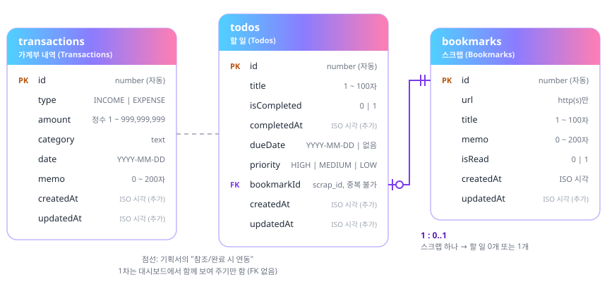

| 관계 | 종류 | 내용 |
|---|:---:|---|
| `bookmarks.id` ← `todos.bookmarkId` | 1 : 0..1 | 스크랩 하나는 할 일 하나로만 전환된다. `bookmarkId`는 중복 불가 인덱스(`&bookmarkId`) |
| `transactions` ·· `todos` | 없음 | 처음 기획서의 "참조/완료 시 연동"은 1차에서 FK 없이 대시보드에 함께 보여 주는 것으로 정리했다 |

- 처음 기획서(PDF)의 이름은 코드에서 camelCase로 바꿨다: `is_completed` → `isCompleted`, `due_date` → `dueDate`, `scrap_id` → `bookmarkId`, `is_read` → `isRead`, `created_at` → `createdAt`
- 기획서에 없던 `createdAt` · `updatedAt` · `completedAt`을 더했다 (그림에서 "추가")

### 3-2. 테이블 정의

**transactions (가계부 내역)** — 인덱스: `date`, `[type+date]`, `category`

| 필드 | 타입 | 필수 | 규칙 |
|---|---|:---:|---|
| id | number | 자동 | PK, 자동 증가 |
| type | `INCOME` \| `EXPENSE` | ✅ | 기본 `EXPENSE` |
| amount | number | ✅ | 정수, 1 ~ 999,999,999 |
| category | string | ✅ | 구분에 맞는 카테고리 목록 안의 값 |
| date | string | ✅ | `YYYY-MM-DD`, 기본 오늘 |
| memo | string | | 0 ~ 200자 |
| createdAt · updatedAt | string | 자동 | ISO 8601 시각 |

**todos (할 일)** — 인덱스: `dueDate`, `isCompleted`, `&bookmarkId`

| 필드 | 타입 | 필수 | 규칙 |
|---|---|:---:|---|
| id | number | 자동 | PK, 자동 증가 |
| title | string | ✅ | 1 ~ 100자, 앞뒤 공백 제거 |
| isCompleted | 0 \| 1 | ✅ | 기본 0 (IndexedDB 인덱스 때문에 숫자로 저장) |
| completedAt | string \| null | | 완료할 때 기록, 되돌리면 null |
| dueDate | string \| null | | `YYYY-MM-DD` 또는 없음 |
| priority | `HIGH` \| `MEDIUM` \| `LOW` | ✅ | 기본 `MEDIUM` |
| bookmarkId | number \| null | | FK → bookmarks.id, 스크랩 하나당 하나 |
| createdAt · updatedAt | string | 자동 | ISO 8601 시각 |

**bookmarks (스크랩)** — 인덱스: `url`(중복 확인), `isRead`, `createdAt`

| 필드 | 타입 | 필수 | 규칙 |
|---|---|:---:|---|
| id | number | 자동 | PK, 자동 증가 |
| url | string | ✅ | http/https만. 스킴이 없으면 `https://` |
| title | string | ✅ | 1 ~ 100자, 비우면 도메인 |
| memo | string | | 0 ~ 200자 |
| isRead | 0 \| 1 | ✅ | 기본 0 |
| createdAt · updatedAt | string | 자동 | ISO 8601 시각 |

### 3-3. 삭제할 때 연결 처리

| 지우는 것 | 처리 |
|---|---|
| 스크랩 | 그 스크랩을 가리키던 할 일의 `bookmarkId`를 null로. 할 일은 남는다 |
| 할 일 | 아무것도 안 함. 스크랩은 남고 다시 할 일로 전환할 수 있다 |

```ts
// src/db/database.ts (1차, 버전 1)
this.version(1).stores({
  transactions: '++id, date, [type+date], category',
  todos: '++id, dueDate, isCompleted, &bookmarkId',
  bookmarks: '++id, url, isRead, createdAt',
})
```

## 4. 기술 구조

| 항목 | 정한 것 |
|---|---|
| 언어 · 화면 | TypeScript, React 18, Tailwind CSS, Vite |
| 저장 | IndexedDB + Dexie (모든 환경 공통), 서버로 데이터를 보내지 않음 |
| 구조 | 화면(pages · components) → 저장소(repositories) → DB(Dexie). 화면은 DB를 직접 만지지 않음 |
| 웹 · 컴퓨터 | PWA. 한 번 열면 인터넷 없이도 열림, 컴퓨터는 "앱 설치"로 따로 창 (Tauri/Electron 안 씀) |
| 폰 앱 | Capacitor 8 (Android, iOS 폴더 준비). 링크는 앱 안 브라우저로 염 |
| 날짜 | 날짜는 `YYYY-MM-DD` 문자열(시간대 문제 피하기), 시각은 ISO 8601 |

## 5. 7일 개발 일정 (계획 → 실제)

| 날 | 계획 | 실제로 한 것 | PR |
|:---:|---|---|:---:|
| 기획 | – | Spec Kit 문서 (spec, plan, data-model, tasks), 2차 기획 | #1, #2 |
| Day 1 | 와이어프레임 확정, Local DB 테이블 생성 | 프로젝트 세팅, 레이아웃(아래 탭/왼쪽 메뉴), Dexie 스키마 | #3 |
| Day 2 | 가계부 입력 폼, 수입/지출 리스트 | 가계부 입력 · 검사, 월별 내역, 합계 | #4 |
| Day 3 | 할 일 CRUD, 체크박스 상태 | 할 일 CRUD, 완료 체크, 오늘/전체 탭 | #5 |
| Day 4 | 스크랩 저장, 외부 링크 연동 | 스크랩 저장, 링크 열기, 읽음 처리 | #6 |
| Day 5 | 대시보드, 스크랩 ➔ 할 일 연동 | 대시보드 카드 3개, 할 일로 전환 | #7, #8 |
| Day 6 | UI/UX 정돈, 예외 처리 · 버그 수정 | 필터, 빈 화면, 저장 실패, 자정 갱신 / 새 디자인 | #9, #10 |
| Day 7 | 시나리오 테스트, 1차 빌드 | 백업 · 가져오기 · 전체 삭제, PWA, 폰 앱 준비, 앱 아이콘 | #11 |

## 6. 플랫폼과 배포

| 환경 | 방법 | 1차 상태 |
|---|---|:---:|
| 💻 컴퓨터 웹 / 📱 폰 웹 | PWA, `npm run build` 결과를 올리면 바로 열림 (vercel.json 준비) | ✅ |
| 💻 컴퓨터 앱 | 브라우저의 "앱 설치"(PWA) | ✅ |
| 📱 안드로이드 앱 | Capacitor `android/` 폴더, Android Studio로 빌드 | ✅ (자동 APK는 2차) |
| 🍎 아이폰 앱 | Capacitor `ios/` 폴더, Mac + Xcode 필요 | 준비만 |

## 7. 품질 확인

- 단위 테스트 11개 파일, **51개 통과** (`npm test`, Vitest + fake-indexeddb)
- 타입 검사 `tsc -b`, 빌드 `npm run build` 통과
- Playwright로 폰(390px) · 컴퓨터 화면에서 주요 흐름 클릭해 보기, 화면 사진은 [docs/screenshots](../../docs/screenshots)

## 8. 2차로 넘긴 것

| 기능 | 2차 결과 |
|---|---|
| 캘린더 · 일기 · 습관 · 적금 | 만듦 (PR #12, #18, #22, #24) |
| 링크 미리보기 · 스크랩 카테고리 · 공유로 저장 | 만듦 (PR #23) |
| 캡처로 가계부 입력 (잔액 확인은 아직) | 만듦 (PR #26) |
| AI 소비 한마디 · AI 비서 (무료 AI) | 만듦 (PR #20, #25, #33) |
| 구글 로그인 + 동기화, 웹 배포 | 3차에 만듦 (PR #49, #51) |

## 9. 화면

| 대시보드 | 가계부 | 입력 검사 | 카테고리 거르기 |
|:---:|:---:|:---:|:---:|
| 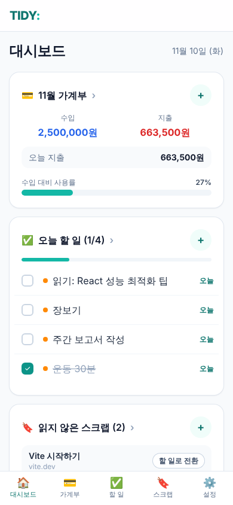 | 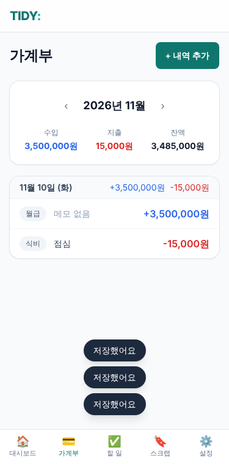 | 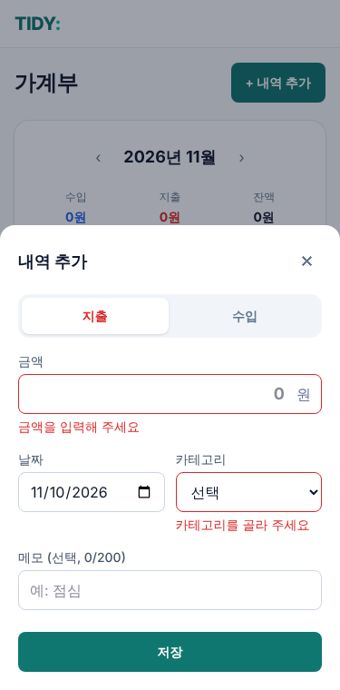 | 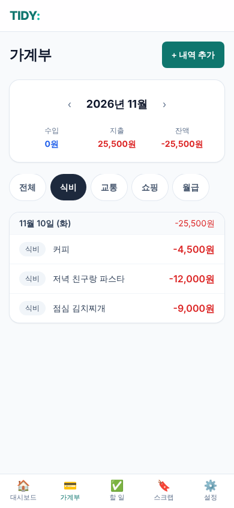 |

| 오늘 할 일 | 전체 할 일 | 스크랩 | 할 일로 전환 |
|:---:|:---:|:---:|:---:|
| 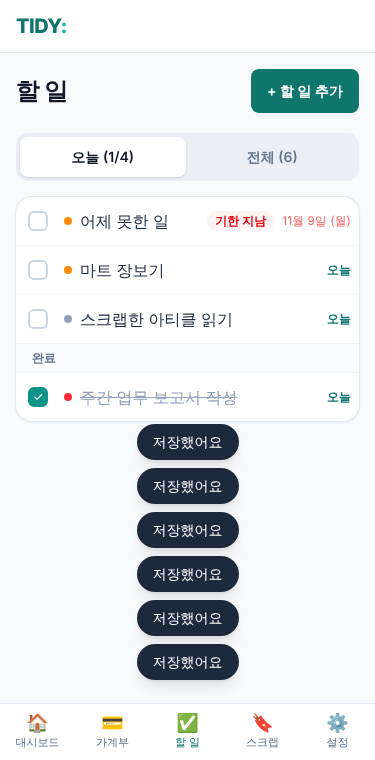 | 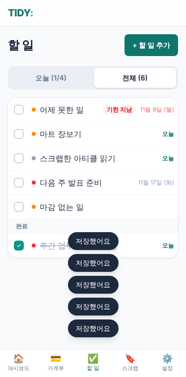 | 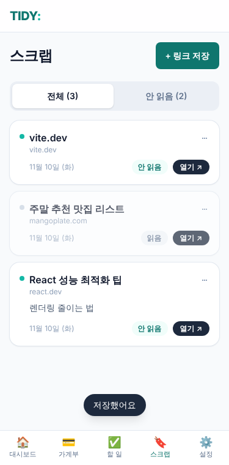 | 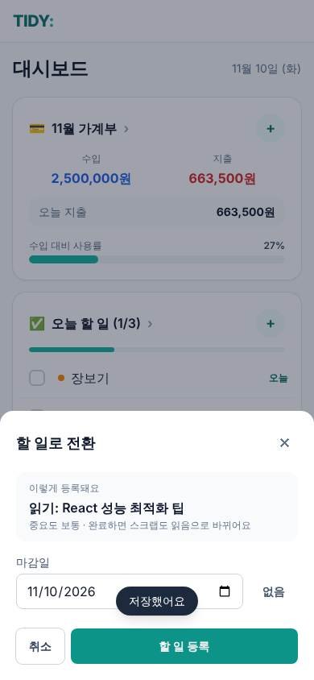 |

| 컴퓨터 화면 | 설정 · 백업 | 백업 가져오기 | 앱 아이콘 |
|:---:|:---:|:---:|:---:|
| 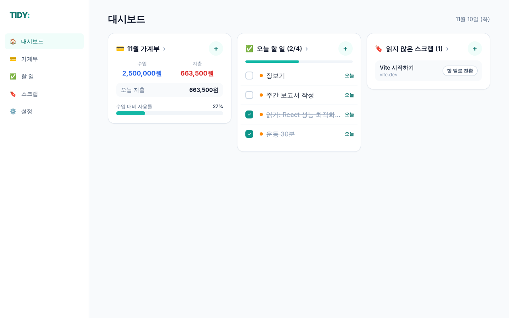 | 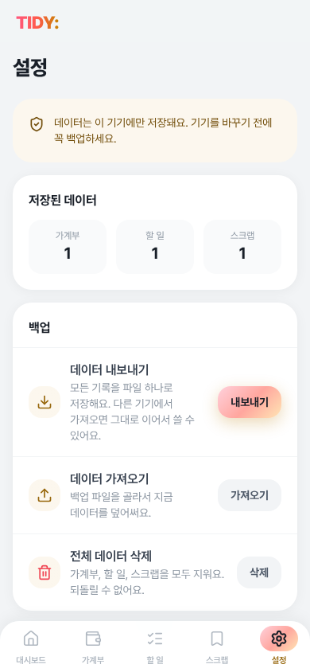 | 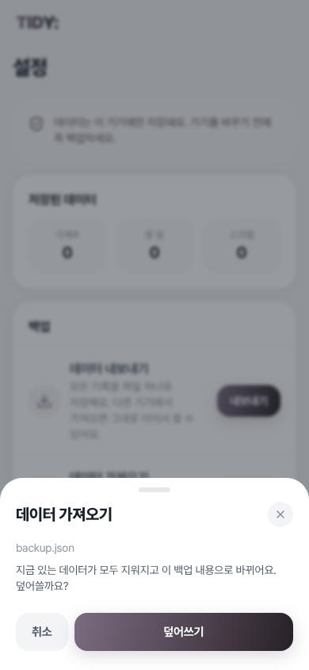 |  |
