# Tidy 2차 요구사항 분석서 및 시스템 설계서

| 항목 | 내용 |
|---|---|
| 작성일 | 2026-11-10 |
| 기준 | 실제로 만든 결과 (`preview/all-features` 브랜치, PR #12 ~ #36) |
| 앞 문서 | [1차 요구사항 분석서](../001-tidy-mvp/requirements.md) ([PDF](../../docs/1차-요구사항-분석서.pdf)) · [2차 처음 기획 (spec.md)](spec.md) |
| PDF 판 | [docs/2차-요구사항-분석서.pdf](../../docs/2차-요구사항-분석서.pdf) (화면 사진 포함) |

> **2차 목표**: 1차의 가계부 · 할 일 · 스크랩을 **매일 쓰는 생활 앱**으로 키운다. 캘린더와 일기, 습관, 적금을 더하고, 사진과 캡처를 찍기만 하면 기록되게 한다. AI는 **무료**로만 쓰고(한도가 있어도 괜찮음), **앱 크기는 키우지 않는다**(큰 AI 모델을 앱에 넣지 않음).

---

## 1. 앱 구조

| 아래 탭 | 보이는 것 |
|---|---|
| 대시보드 | 이번 달 가계부 · AI 소비 한마디 · 들어올 돈(월급 D-day) · 오늘 할 일 · 오늘 습관 · 읽지 않은 스크랩 · 적금 |
| 가계부 | 목록 / 달력, ≡ 메뉴, 📷 캡처 입력, 적금 |
| 할 일 | 오늘 / 나중 / 전체 / 습관 |
| 일기 | 하루 글 + 사진 타임라인, 지난 일기 |
| 캘린더 | 일정 막대, 할 일, 일기 사진, 금액 보기 |
| 스크랩 | 카테고리, 미리보기 카드, 캡처, AI 요약 |

- 화면 위: 🌗 화면 밝기, ⚙️ 설정 / 오른쪽 아래: **AI 비서** 동그라미 버튼
- 가계부 머리의 **≡ 메뉴**: 차트, 통계, 고정 금액, 정기 내역 / **📷**: 캡처·음식 사진 입력 / **적금**
- 설정: AI 연결, 꾸미기, 백업, 화면 밝기

## 2. 2차 기능 요구사항 명세표

상태: ✅ 만들었음 · 🧪 만들었지만 실제 키로 아직 못 써 봄 · ⏳ 검토 중(PR 열림)

### 2-1. 가계부

| 기능 | 요구사항 상세 | 우선순위 | 상태 | PR |
|---|---|:---:|:---:|:---:|
| 시간 · 결제 수단 · 자세히 보기 | 내역마다 시간, 카드/계좌 이름. 누르면 자세히 보기 | P1 | ✅ | #14 |
| 가게 로고 | 다이소, 올리브영 같은 브랜드는 로고와 "지점 + 가게 이름 -금액"으로 표시 | P2 | ✅ | #13 |
| 모르는 결제처 물어보기 | KCP, NICE 같은 결제 대행사 이름이면 "어디서 쓴 거예요?" 묻고 기억 | P1 | ✅ | #16 |
| 정기 내역 + 월급 D-day | 매달 같은 날 들어오고 나가는 돈 자동 기록, 다음 월급까지 남은 날 | P1 | ✅ | #15 |
| 차트 · 통계 · 고정 금액 (≡) | 카테고리 도넛, 주/월 추이, 수입 대비 사용률, 고정비 모아 보기 (차트 라이브러리 없이 직접 그림) | P1 | ✅ | #17 |
| 목록 / 달력 보기 | 가계부를 달력으로, 날짜마다 수입·지출 합계 | P1 | ✅ | #18 |
| 캡처로 입력 | 은행·카드 앱 캡처 → **기기 안 글자 인식(무료, AI 없음)** → 날짜·금액·가게 → 확인 후 저장 | P1 | ✅ | #26 |
| 음식 사진으로 식비 기록 | 사진의 위치·시간 → 근처 가게 → 메뉴와 가격 추정 → "이 가격 맞아요?" | P2 | 🧪 | #21, #27 |
| AI 소비 한마디 | 대시보드 카드. 피드백 / 절약 잔소리 / 무조건 칭찬 3가지 말투 | P2 | ✅ | #20 |
| 적금 | 만기 금액(세전/세후) 계산, 자동 납입 기록, 연결 습관, 납입일 알림 | P1 | ✅ | #24 |

### 2-2. 할 일 · 캘린더 · 습관 · 일기

| 기능 | 요구사항 상세 | 우선순위 | 상태 | PR |
|---|---|:---:|:---:|:---:|
| 캘린더 | 월 달력에 일정(여러 날 막대)과 할 일, 날짜를 눌러 바로 추가, 금액 보기 켜고 끄기 | P0 | ✅ | #12, #18 |
| 나중 할 일 | 마감일 없는 할 일을 따로 모아 보기 | P2 | ✅ | #18 |
| 습관 트래커 | 습관 만들기(매일/매주/매달), 날짜별 체크, 연속 일수 🔥 | P1 | ✅ | #22 |
| 일기 | 하루 하나, 글 + 사진. 캘린더 날짜 뒤에 사진이 흐리게 보임 | P1 | ✅ | #18 |
| 일기 사진 타임라인 | 하루 **사진 최대 10장**, 사진마다 찍은 시간 + 한 줄 메모, **시간 순서 타임라인** | P1 | ⏳ | #36 |
| 아이폰 사진(HEIC) | 아이폰 사진을 기기 안에서 JPEG로 바꿔서 넣기 (필요할 때만 불러옴) | P0 | ✅ | #35 |

### 2-3. 스크랩

| 기능 | 요구사항 상세 | 우선순위 | 상태 | PR |
|---|---|:---:|:---:|:---:|
| 카테고리 | 맛집·카페, 여행, 쇼핑, 공부 등 직접 만들고 순서 바꾸기 | P1 | ✅ | #23 |
| 링크 미리보기 | 제목, 썸네일, 출처(Instagram, 네이버, X, YouTube) 자동 | P1 | ✅ | #23 |
| 공유로 저장 | 다른 앱의 "공유" → Tidy (안드로이드, PWA) | P1 | ✅ | #23 |
| 캡처 같이 저장 | 게시물이 지워져도 볼 수 있게 화면 캡처·녹화 저장, 사진 편집(자르기, 글씨) | P2 | ✅ | #23 |
| 인스타 영상 앱 안에서 보기 | 공식 임베드로 재생 (내려받기 안 함) | P2 | ✅ | #23 |
| AI 요약 | 스크랩 내용을 3줄 요약 (Gemini 무료 → Groq 예비) | P2 | ✅ | #33, #34 |

### 2-4. AI 비서 (무료)

| 기능 | 요구사항 상세 | 우선순위 | 상태 | PR |
|---|---|:---:|:---:|:---:|
| 대화로 등록 | 포스터 사진 → 캘린더, 결제 내역 캡처 → 가계부, 오늘 이야기 → 일기. "내가 등록할게"로 직접 고치기 | P1 | ✅ | #25 |
| 물어보기 | 예금·적금, 청년도약계좌·청년내일저축·청약통장, 돈 관리, 소비 습관, 자기관리 질문. **구글 검색으로 최신 정보 + 출처 링크** | P1 | ✅ | #33 |
| 오타 · 줄임말 | 오타가 있어도 뜻을 짐작해서 답 | P1 | ✅ | #33 |
| 엔진 차례 | Gemini 무료 → (한도 끝) Groq 무료 → (둘 다 안 되면) 기본 모드(규칙, 인터넷 없이) | P0 | 🧪 | #28–#30, #34, #35 |
| 말로 쓰기 | 폰 앱에서 동작하지 않아 **사용자 요청으로 뺌** | – | 제거 | #33 |

### 2-5. 꾸미기 · 화면

| 기능 | 요구사항 상세 | 우선순위 | 상태 | PR |
|---|---|:---:|:---:|:---:|
| 켤 때마다 바뀌는 색 | 구역마다 세 가지 색 그라데이션, 견본 18개 + 새로 만들기 | P1 | ✅ | #10 |
| 다크 / 라이트 / 자동 | 화면 밝기 3가지 | P1 | ✅ | #19 |
| 꾸미기 사진 | 배경·대시보드·가계부·할 일 등 구역마다 **사진 최대 10장**(켤 때마다 한 장), 투명도, **전체 보이기 / 꽉 채우기**, 보여 줄 곳(위/가운데/아래) | P1 | ✅ | #19, #33 |
| 체크 색 고르기 + 미리보기 | 할 일·습관 체크 색, 적용 전 미리보기 | P2 | ✅ | #19 |
| 칸 크기 맞추기 | 컴퓨터 대시보드 카드 크기 같게, 작은 폰에서 가계부 제목 안 접힘 | P2 | ✅ | #29, #31 |

### 2-6. 앱 · 보안

| 기능 | 요구사항 상세 | 우선순위 | 상태 | PR |
|---|---|:---:|:---:|:---:|
| 안드로이드 앱(APK) | 저장소에 올리면 자동으로 APK를 만들어 Releases에 올림 | P0 | ✅ | #26, #32 |
| 지우지 않고 업데이트 | 같은 서명 키 + 올라가는 버전 번호 → 새 APK를 깔면 기록 그대로 | P0 | ✅ | #32 |
| 보안 점검 | http/https 아닌 링크 막기(백업 파일 포함), 보안 헤더, 키는 기기 안에만 | P0 | ✅ | #33 |

## 3. 데이터베이스 설계 (기기 안 IndexedDB)

1차의 3개 테이블에 9개를 더했다. 버전을 올릴 때 옛 데이터는 그대로 둔다.

| 버전 | 추가 · 변경 | 테이블 |
|:---:|---|---|
| v1 | 1차 | `transactions`, `todos`, `bookmarks` |
| v2 | 정기 내역 | `recurring` (type, amount, category, day, startDate, lastDate, isActive) |
| v3 | 결제처 이름 기억 | `merchantAliases` (raw → name) |
| v4 | 캘린더 · 일기 | `events` (startDate ~ endDate, color), `diaries` (date 키, text, photo, **photos[]**) |
| v5 | 스크랩 확장 | `scrapCategories`, `scrapMedia` (썸네일·캡처 Blob), `bookmarks.categoryId` |
| v6 | 습관 | `habits` (title, emoji, schedule, savingsId), `habitChecks` ([habitId+date]) |
| v7 | 적금 | `savings`, `transactions.savingsId` (적금 납입 기록 찾기) |
| 따로 | 꾸미기 사진 | DB `tidy-photos` (사진 Blob, 설정에는 `idb:번호`만) |

```text
transactions ──┬── recurringId ──> recurring
               └── savingsId ────> savings <── savingsId ── habits ──< habitChecks
todos ── bookmarkId ──> bookmarks ── categoryId ──> scrapCategories
                              └──< scrapMedia
events (기간)      diaries (하루 하나: photos[] = {src, time, note})
```

- **일기 사진** (`DiaryPhoto`): `src` 작게 줄인 JPEG · `time` HH:mm · `note` 한 줄 메모. 첫 장이 `photo`(캘린더 대표)
- **백업**: 설정 → JSON 내보내기/가져오기에 모든 테이블이 들어가고, 가져올 때 모양을 하나하나 검사한다

## 4. AI 구조 (무료만)

```text
사용자 ──> AI 비서 ──> ① Gemini 무료 (구글 검색 · 사진 읽기)
                        │ 한도 끝 / 오류
                        ▼
                      ② Groq 무료 (llama-3.3-70b → llama-3.1-8b, 글만)
                        │ 키 없음 / 한도 끝
                        ▼
                      ③ 기본 모드 (규칙, 인터넷 없이, 항상 동작)
```

| 항목 | 정한 것 |
|---|---|
| 비용 | 유료 API(Claude 등)는 쓰지 않음. Gemini · Groq 무료 키를 사용자가 설정에 넣음 |
| 키 저장 | 그 기기 안에만. 서버로 보내지 않음 |
| 한도 | Gemini는 한국 시간 오후 5시에 다시 채워짐. 한도가 끝나면 다음 엔진으로 |
| 사진 | Gemini가 읽음. Groq는 사진을 못 읽어서 기기 안 글자 인식 결과를 글로 보냄 |
| 앱 크기 | AI 모델을 앱에 넣지 않음. 글자 인식·HEIC 변환은 쓸 때만 불러옴 |
| 폰 앱 연결 | 폰 앱(WebView)에서는 Groq를 폰 자체 인터넷 기능(CapacitorHttp)으로 부름 |

## 5. 플랫폼과 배포

| 환경 | 방법 | 상태 |
|---|---|:---:|
| 📱 안드로이드 앱 | [Releases](https://github.com/kcr522/tidy/releases/latest)의 `tidy.apk` (깃허브 로그인 필요), 덮어 깔면 업데이트 | ✅ |
| 💻 컴퓨터 / 📱 폰 웹 | PWA. 인터넷 주소(Vercel)에 올리면 바로 열 수 있음 | ⏳ 배포 전 |
| 🍎 아이폰 앱 | Mac + Xcode로 빌드 가능, 앱스토어는 계획 없음 | – |

## 6. 품질 확인

- 단위 테스트 30개 파일, **232개 통과** (`npm test`)
- 타입 검사 `tsc -b`, 빌드 `npm run build` 통과
- Playwright로 390px 폰 화면에서 주요 흐름 클릭해 보기, 화면 사진은 [docs/screenshots](../../docs/screenshots)

## 7. 아직 안 만든 것 (3차 후보)

| 기능 | 내용 | 메모 |
|---|---|---|
| 🔐 구글 로그인 + 동기화 | 폰·컴퓨터 같은 기록, 10명 정도까지 Firebase | 정해만 둠. Apple 로그인은 앱스토어에 낼 때만 |
| 🌐 웹 배포 | Vercel에 올려서 링크로 열기 | 보안 헤더 설정은 준비됨 |
| 💳 잔액 캡처 확인 | 은행 잔액 화면으로 앱 잔액과 맞춰 보기 | 1차 기획 US5 |
| 🍎 아이폰 공유로 스크랩 | iOS Share Extension 필요 | 안드로이드는 됨 |
| 💰 월 예산 | 카테고리별 한도, 80% 넘으면 알림 | 추천 |
| 🔁 반복 할 일 + 알림 | "매주 월요일 분리수거" | 추천 |
| 🔒 앱 잠금 | 지문·비밀번호 (일기와 돈 기록 보호) | 추천 1순위 |
| 🔎 전체 검색 | 가계부·할 일·스크랩·일기 한 번에 | |
| 📊 월말 리포트 | 한 달 소비·습관을 AI가 한 장으로 | |
| 📱 홈 화면 위젯 | 오늘 할 일, 오늘 쓴 돈 | 안드로이드 네이티브 작업 |
| ☁️ 자동 백업 | 구글 드라이브에 주마다 | |
| 🗓 구글 캘린더 연동 | 일정 가져오기·내보내기 | |

## 8. 화면

| 대시보드 | AI 비서 | 가계부 달력 | 캘린더 |
|:---:|:---:|:---:|:---:|
| 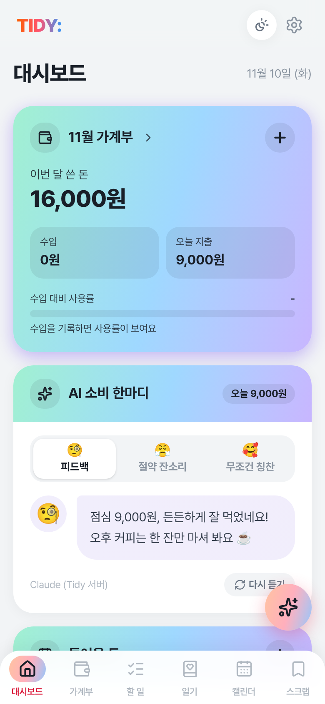 |  | 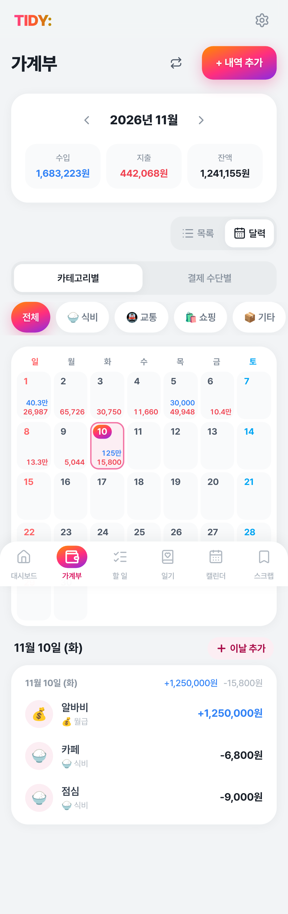 | 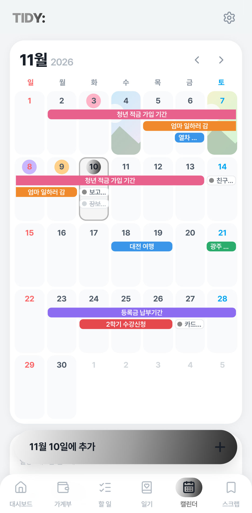 |

| 일기 타임라인 | 습관 | 적금 | 스크랩 |
|:---:|:---:|:---:|:---:|
| 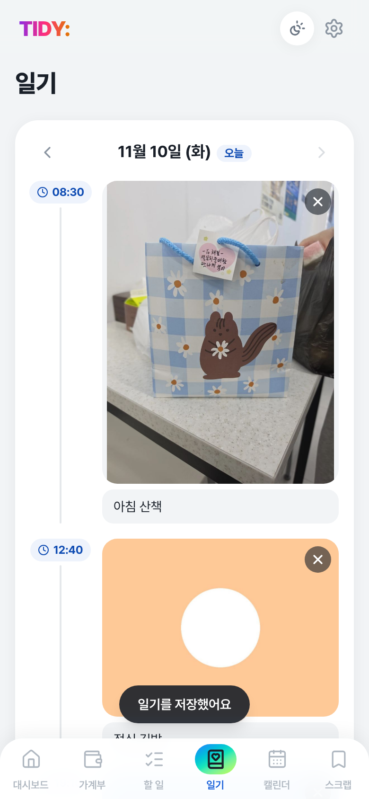 | 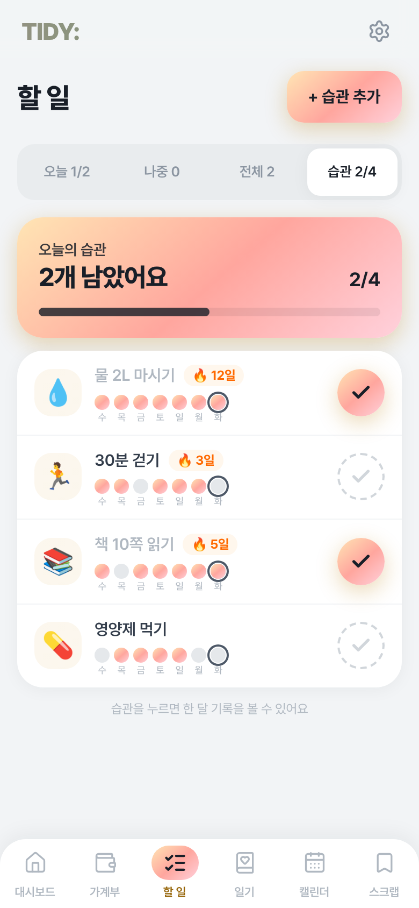 | 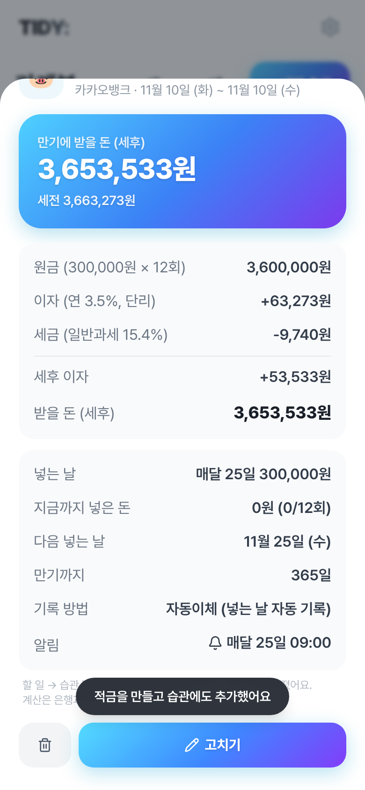 | 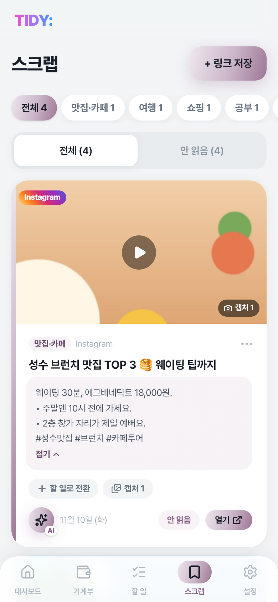 |

| 캡처로 입력 | 꾸미기 사진 | 사진 맞춤 | AI 연결 (Groq 예비) |
|:---:|:---:|:---:|:---:|
| 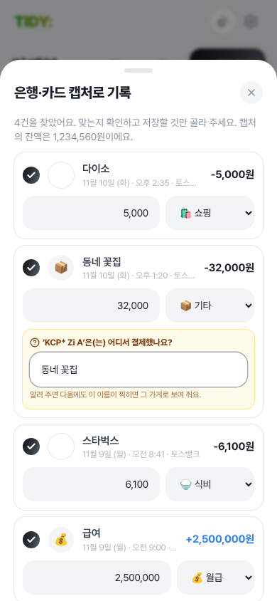 | 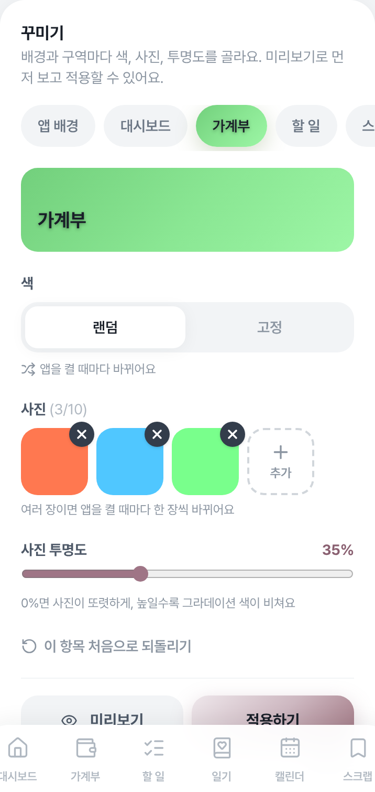 | 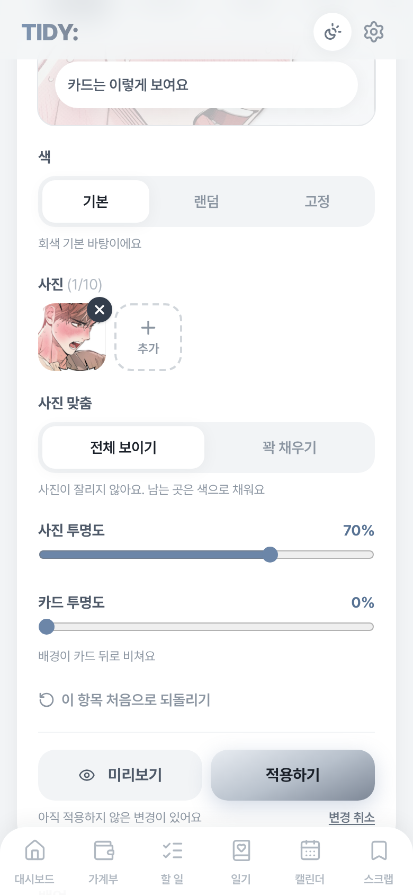 | 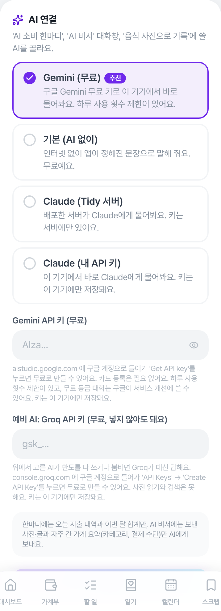 |
